# Ingenieurlösungen für Hausboote und Yachten

Wir entwickeln und fertigen Stellantriebe und mechanische Einheiten: Geräte, die Gas und Rücklauf fernsteuern, den Motor drehen, Plattformen heben und senken, eine Anlegerampe zum Ufer absenken. Hardware, die auf dem Wasser arbeitet.

## Motorsteuerung

<a class="card" href="products/EC325/">
  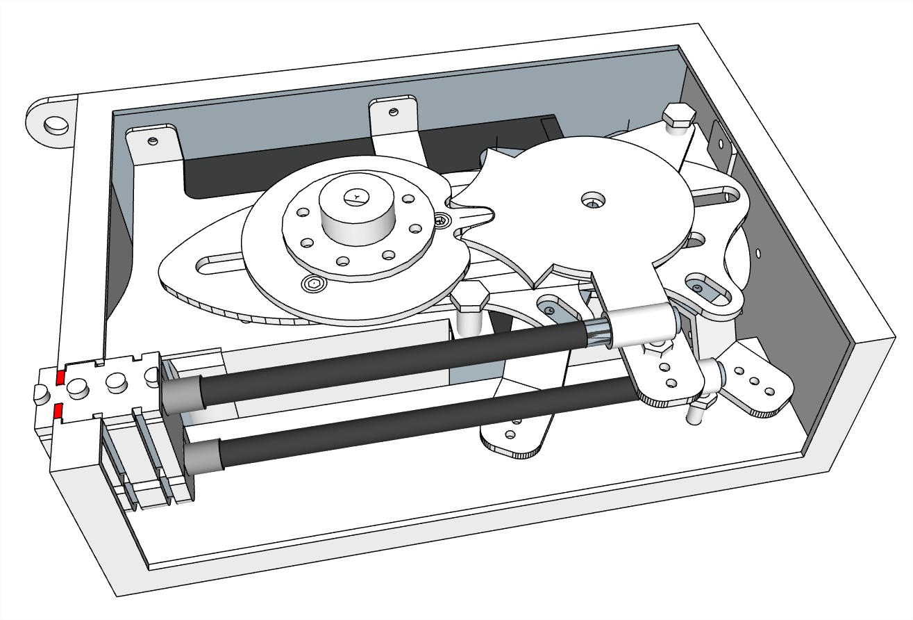
  **EC325** — Engine Control
  <small>Elektronisch-mechanisches Gerät zur Fernsteuerung des Gases und der Umkehrung eines hängenden oder stationären Motors.</small>
  <em>2.300 €</em>
</a>
<a class="card" href="products/MT425/">
  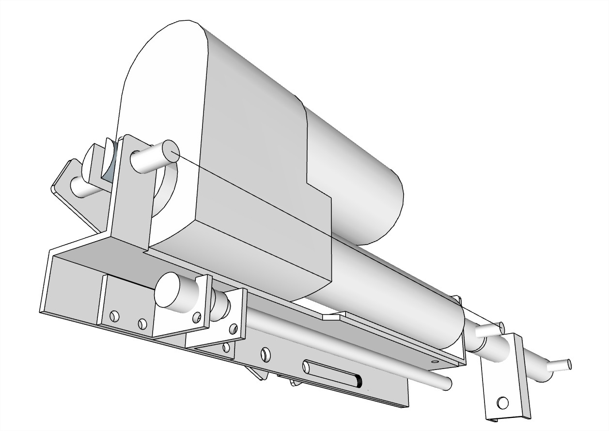
  **MT425** — Motor Turn
  <small>Elektronisch-mechanisches Gerät zur Fernsteuerung der Drehung.</small>
  <em>3.000 €</em>
</a>
<a class="card" href="products/EH125/">
  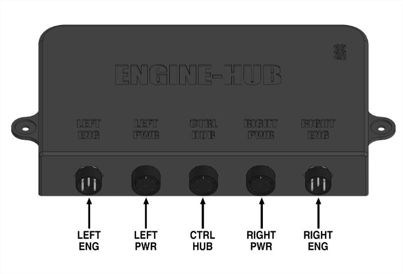
  **EH125** — ENG-HUB
  <small>Schalteinheit zur Steuerung von zwei Motoren.</small>
  <em>830 €</em>
</a>
<a class="card" href="products/CH125/">
  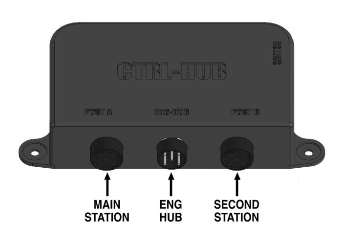
  **CH125** — CTRL-HUB
  <small>Regelverteiler für die Organisation der Verwaltung mit zwei posts.</small>
  <em>610 €</em>
</a>
<a class="card" href="products/ML324/">
  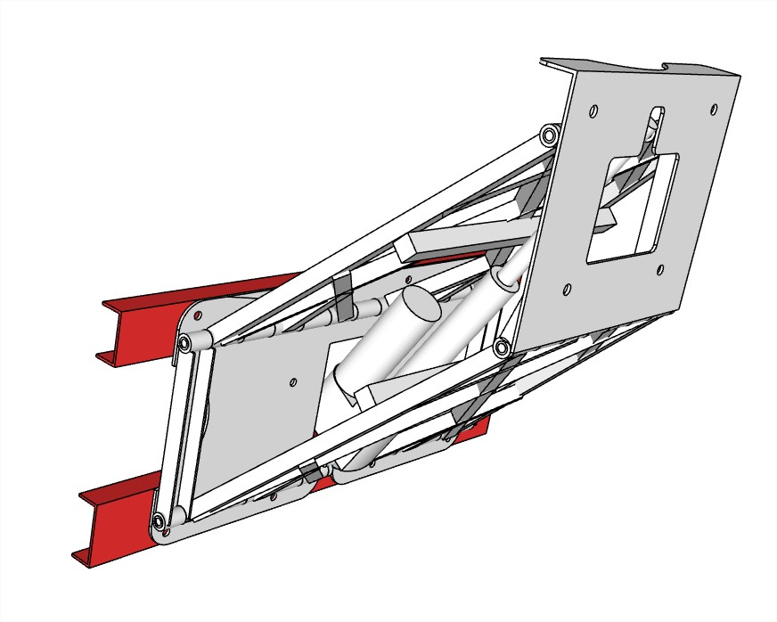
  **ML324** — Motor Lift
  <small>Elektrisch verstellbarer Heck zur Höhenverstellung des Außenbordmotors.</small>
  <em>2.900 €</em>
</a>
<a class="card" href="products/HS124/">
  
  **HS124** — Hydraulische Selector
  <small>Steuerung von zwei Motoren mit einem Lenkrad.</small>
  <em>5.000 €</em>
</a>
<a class="card" href="products/HB124/">
  
  **HB124** — Hydraulische Block
  <small>Blockiert den Betrieb eines oder mehrerer Lenksäulen.</small>
  <em>3.500 €</em>
</a>

## Steuerpulte

<a class="card" href="products/DRC225/">
  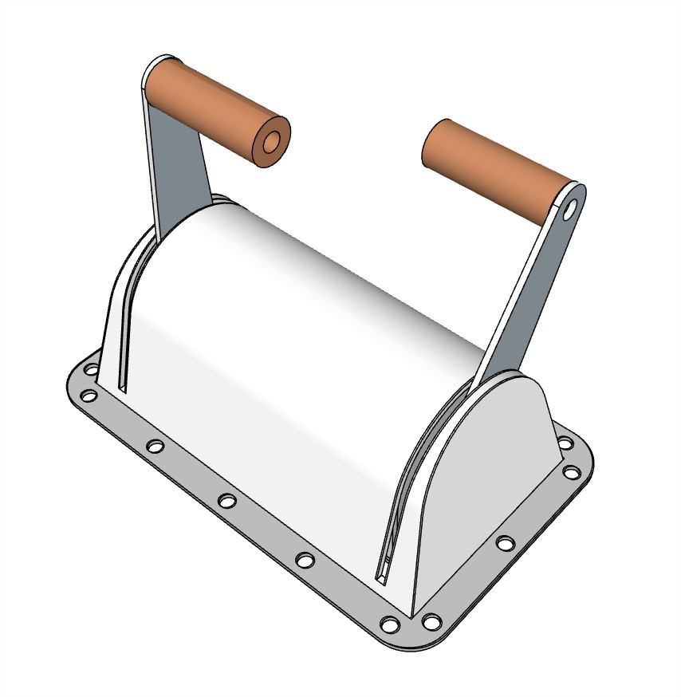
  **DRC225** — Remote Control
  <small>Fernbedienung.</small>
  <em>610 €</em>
</a>
<a class="card" href="products/DRC226/">
  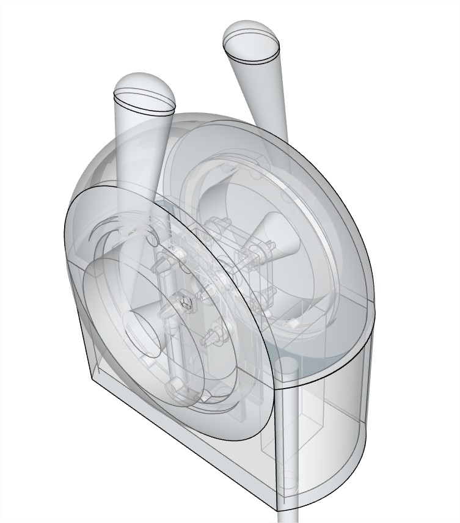
  **DRC226** — Remote Control
  <small>Fernbedienung.</small>
  <em>890 €</em>
</a>
<a class="card" href="products/SRC225/">
  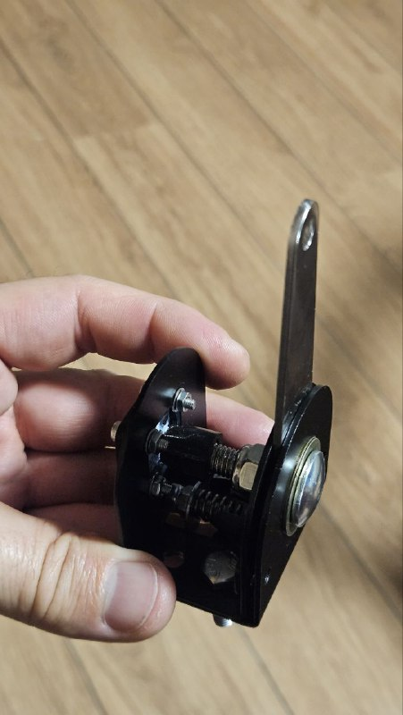
  **SRC225** — Remote Control
  <small>Fernbedienung.</small>
  <em>350 €</em>
</a>
<a class="card" href="products/SRC226/">
  
  **SRC226** — Remote Control
  <small>Fernbedienung.</small>
  <em>470 €</em>
</a>
<a class="card" href="products/ARC126/">
  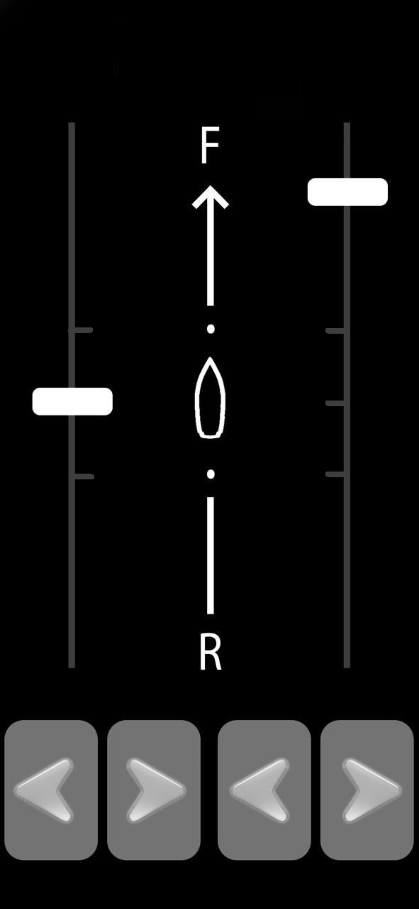
  **ARC126** — Remote Control App
  <small>Fernbedienung mit einem oder zwei Motoren von einem Android-Gerät.</small>
  <em>Preis auf Anfrage</em>
</a>
<a class="card" href="products/CRC000/">
  
  **CRC000** — Veränderbare Kontrollposten.
  <small>Lenkung-racks, Konsolen, Tische, пенели Geräte.</small>
  <em>Preis auf Anfrage</em>
</a>
<a class="card" href="products/CP000/">
  
  **CP000** — Tischmontierbare für zwei Motoren
  <small>Tischmontierbare Schalttafel mit Steuerungsoraganen (Zündung, Start, Stopp) für zwei Motoren.</small>
  <em>Preis auf Anfrage</em>
</a>

## Plattformen und Rampen

<a class="card" href="products/SP121/">
  
  **SP121** — Heck-Bade-/Transportplattform
  <small>Heck-Bade-/Transportplattform mit vier Elektrozylindern.</small>
  <em>14.000 €</em>
</a>
<a class="card" href="products/SP226/">
  
  **SP226** — Heck-Bade-/Transportplattform
  <small>Heck-Bade-/Transportplattform an einem elektrisch angetriebenen Halter.</small>
  <em>Preis auf Anfrage</em>
</a>
<a class="card" href="products/BA118/">
  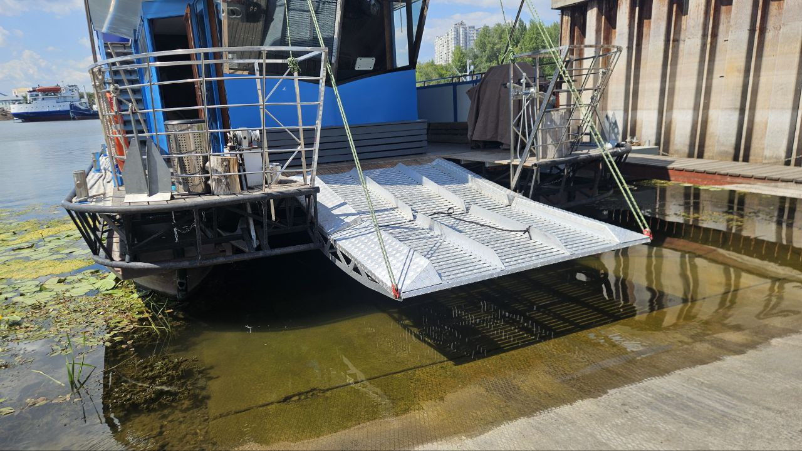
  **BA118** — Rampe
  <small>Eine zusammengesetzte Nasenplattform, die an Land oder Liegeplatz fällt.</small>
  <em>8.700 €</em>
</a>

## Kommunikation und Internet

<a class="card" href="products/IA125/">
  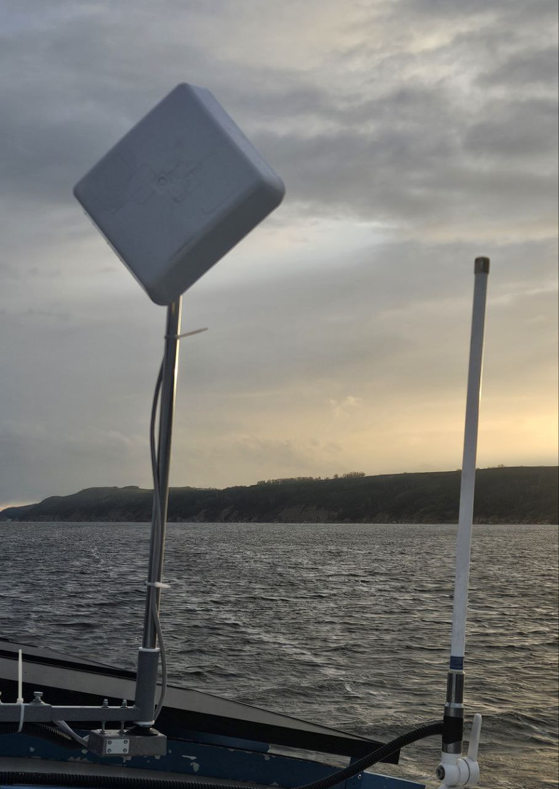
  **IA125** — Antenne
  <small>Richtungsgesteuertes Gerät.</small>
  <em>710 €</em>
</a>

## Zubehör

<a class="card" href="products/BT121/">
  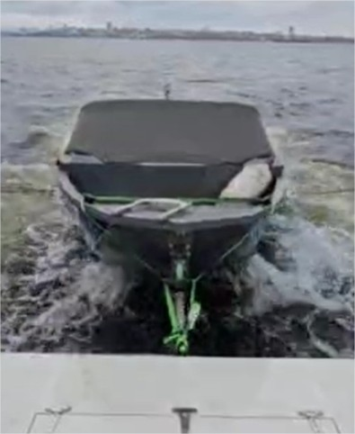
  **BT121** — BootStütz
  <small>Ein Gerät zum sicheren Abschleppen des Bootes.</small>
  <em>410 €</em>
</a>

## Dienstleistungen

<a class="card" href="products/CW000/">
  
  **CW000** — Montage, Inbetriebnahme und Einstellung
  <small>.</small>
  <em>Preis auf Anfrage</em>
</a>

## Kontakte

- [Telegram](https://t.me/+79276867402)  
- [WhatsApp](https://wa.me/+79276867402)  
- [email](mailto:1@vodoplav.ru)
