# Инженерные решения для плавдомов и яхт

Проектируем и производим исполнительные механизмы: устройства, которые дистанционно управляют газом и реверсом мотора, поворачивают его, поднимают и опускают платформы, опускают аппарель на берег. Железо, которое работает на воде.

## Управление моторами

<a class="card" href="products/EC325/">
  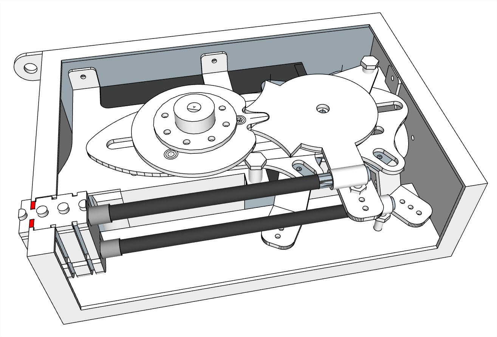
  **EC325** — Блок управления Engine Control
  <small>Электронно-механический блок для дистанционного управления газом и реверсом подвесного или стационарного мотора.</small>
  <em>220 000 ₽</em>
</a>
<a class="card" href="products/MT425/">
  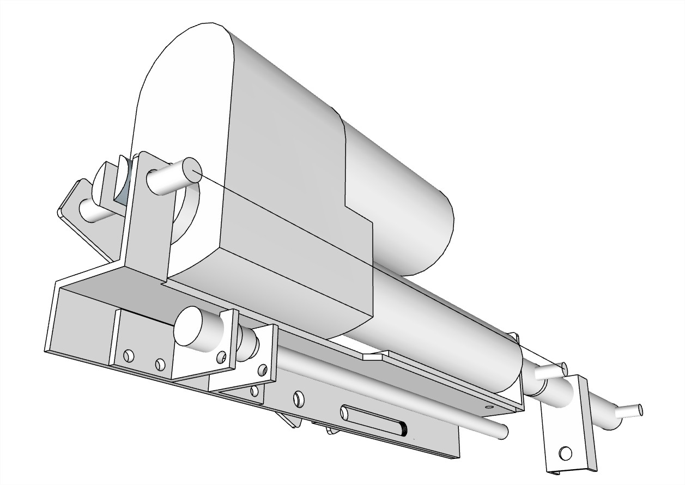
  **MT425** — Рулевой блок Motor Turn
  <small>Электронно-механический блок для дистанционного управления поворотом.</small>
  <em>286 000 ₽</em>
</a>
<a class="card" href="products/EH125/">
  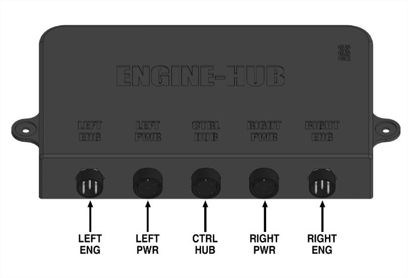
  **EH125** — Коммутатор моторов ENG-HUB
  <small>Коммутационный блок для организации управления двумя моторами.</small>
  <em>75 000 ₽</em>
</a>
<a class="card" href="products/CH125/">
  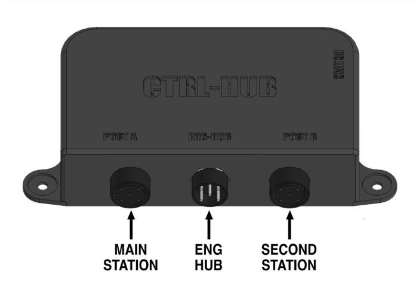
  **CH125** — Комутатор постов CTRL-HUB
  <small>Коммутационный блок для организации управления с двух постов.</small>
  <em>55 000 ₽</em>
</a>
<a class="card" href="products/ML324/">
  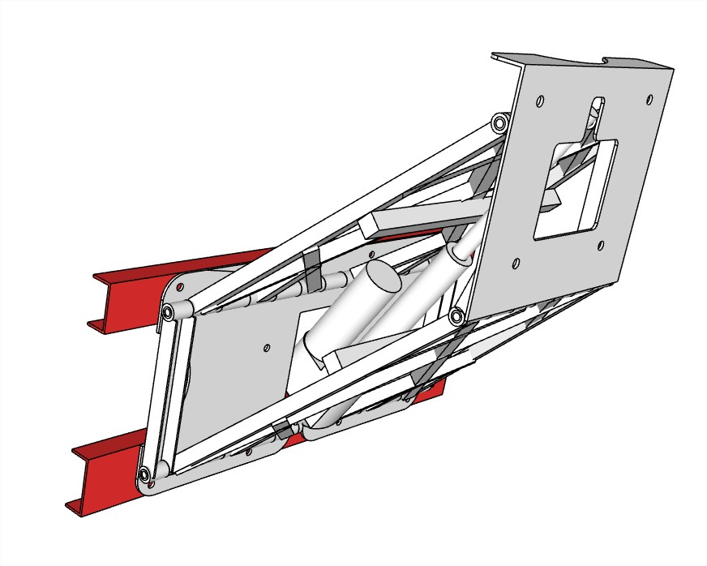
  **ML324** — Регулируемый транец (подъемник мотора) (лифт мотора)
  <small>Транец с электроприводом для регулировки высоты положения подвесного лодочного мотора.</small>
  <em>275 000 ₽</em>
</a>
<a class="card" href="products/HS124/">
  
  **HS124** — Гидроселектор
  <small>Управление двумя моторами одним штурвалом.</small>
  <em>473 000 ₽</em>
</a>
<a class="card" href="products/HB124/">
  
  **HB124** — Гидроблокиратор
  <small>Блокирует работу одного или нескольких рулевых постов управления.</small>
  <em>330 000 ₽</em>
</a>

## Посты управления

<a class="card" href="products/DRC225/">
  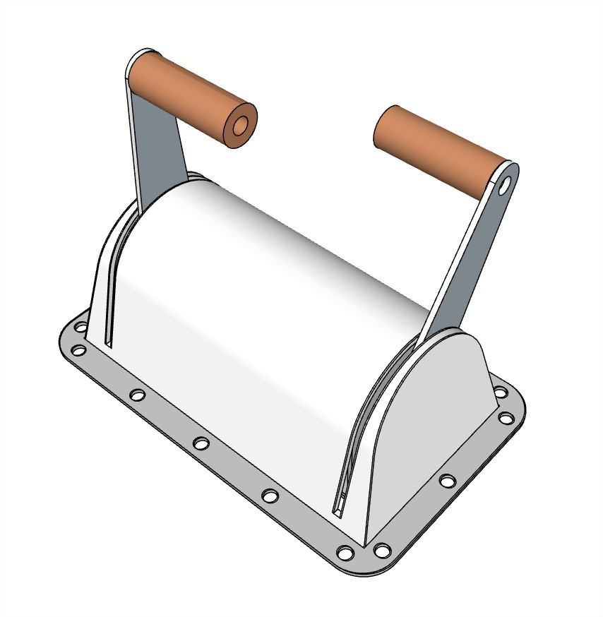
  **DRC225** — Пост управления Remote Control
  <small>Дистанционное управление.</small>
  <em>55 000 ₽</em>
</a>
<a class="card" href="products/DRC226/">
  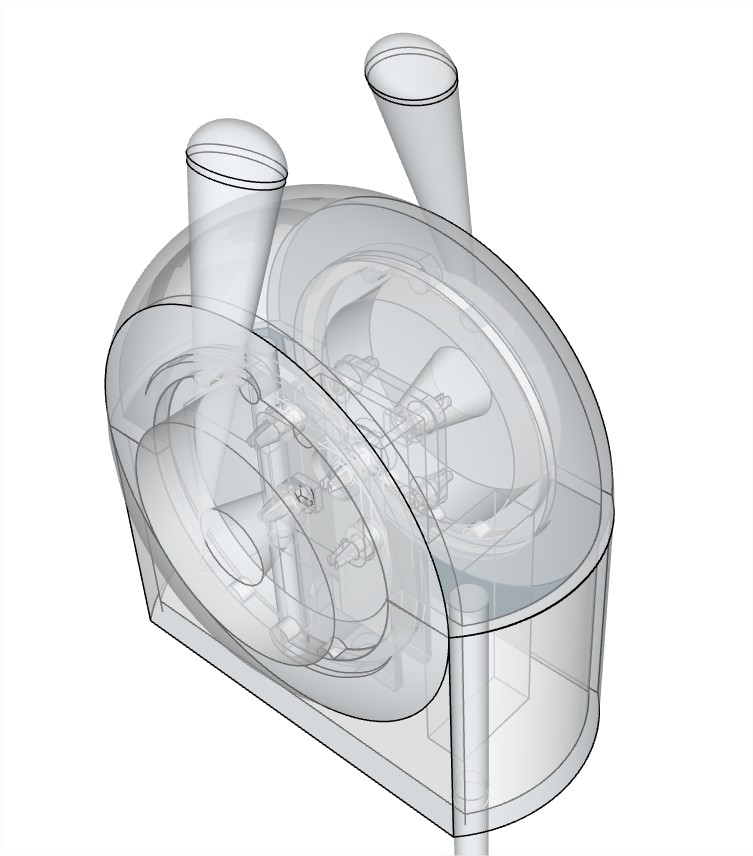
  **DRC226** — Пост управления Remote Control
  <small>Дистанционное управление.</small>
  <em>83 500 ₽</em>
</a>
<a class="card" href="products/SRC225/">
  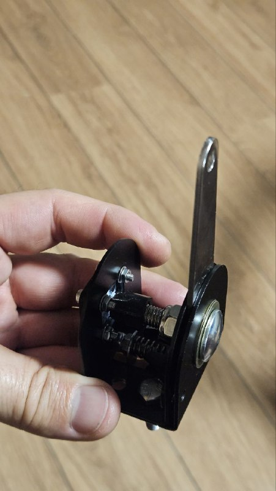
  **SRC225** — Пост управления Remote Control
  <small>Дистанционное управление.</small>
  <em>31 400 ₽</em>
</a>
<a class="card" href="products/SRC226/">
  
  **SRC226** — Пост управления Remote Control
  <small>Дистанционное управление.</small>
  <em>43 500 ₽</em>
</a>
<a class="card" href="products/ARC126/">
  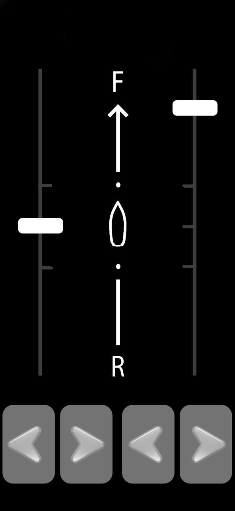
  **ARC126** — Приложение Remote Control
  <small>Дистанционное управление одним или двумя моторами с Android-устройства.</small>
  <em>цена по запросу</em>
</a>
<a class="card" href="products/CRC000/">
  
  **CRC000** — Индивидуальный пост управления
  <small>Рулевые стойки, консоли, столы, пенели приборов.</small>
  <em>цена по запросу</em>
</a>
<a class="card" href="products/CP000/">
  
  **CP000** — Панель зажигания для двух двигателей
  <small>Монтируемая в стол панель с ораганами управления (зажигание, старт, стоп) для двух двигателей.</small>
  <em>цена по запросу</em>
</a>

## Платформы и аппарели

<a class="card" href="products/SP121/">
  
  **SP121** — Кормовая платформа подвесная
  <small>Кормовая купальная/транспортировочная платформа на четырех электроцилиндрах.</small>
  <em>1 320 000 ₽</em>
</a>
<a class="card" href="products/SP226/">
  
  **SP226** — Кормовая платформа транцевая
  <small>Кормовая купальная/транспортировочная платформа на кронштейне с электроприводом.</small>
  <em>цена по запросу</em>
</a>
<a class="card" href="products/BA118/">
  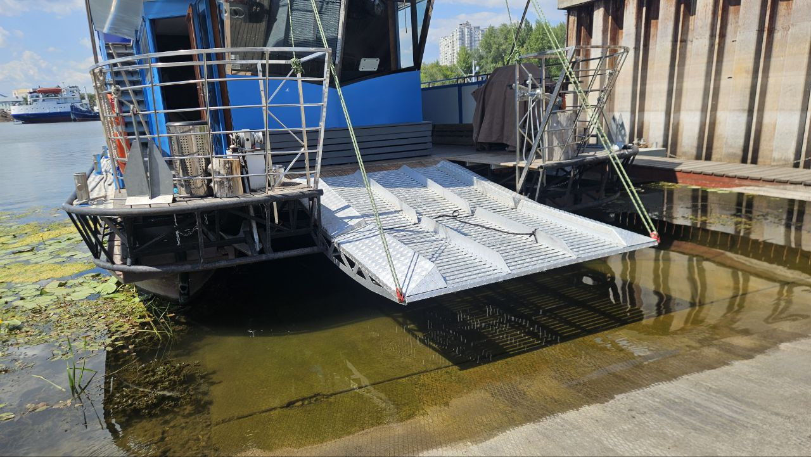
  **BA118** — Аппарель
  <small>Составная носовая платформа, опускающаяся на берег или причал.</small>
  <em>825 000 ₽</em>
</a>

## Связь и интернет

<a class="card" href="products/IA125/">
  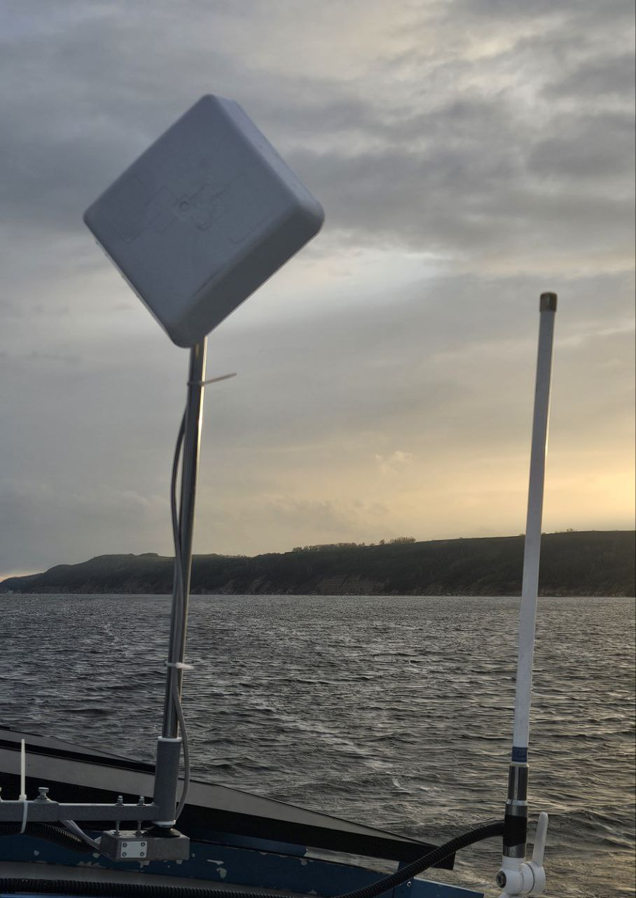
  **IA125** — Адаптивная управляемая интернет-антенна
  <small>Устройство направленного действия.</small>
  <em>67 300 ₽</em>
</a>

## Аксессуары

<a class="card" href="products/BT121/">
  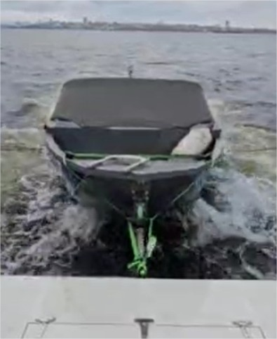
  **BT121** — Упор для буксировки лодки
  <small>Устройство для безопасной буксировки лодки.</small>
  <em>38 500 ₽</em>
</a>

## Услуги

<a class="card" href="products/CW000/">
  
  **CW000** — Монтаж, пусконаладка и настройка навигационного оборудования.
  <small>.</small>
  <em>цена по запросу</em>
</a>

## Контакты

- [Telegram](https://t.me/+79276867402)  
- [WhatsApp](https://wa.me/+79276867402)  
- [email](mailto:1@vodoplav.ru)
