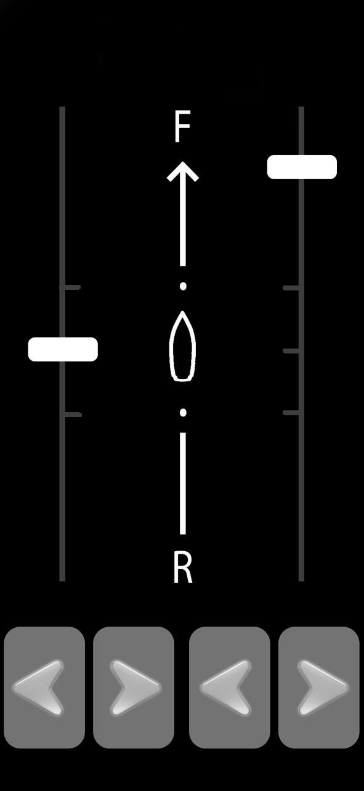
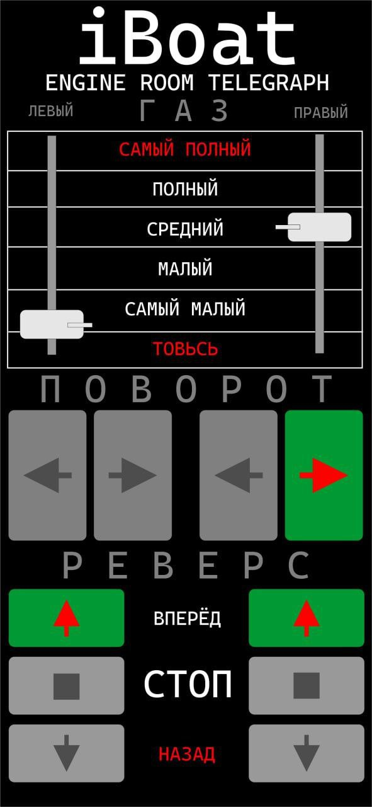

# Remote Control App «ARC126»

**Kategorie:** Steuerpulte  

Fernbedienung mit einem oder zwei Motoren von einem Android-Gerät.

## Galerie

## Detaillierte Beschreibung

Eine an die gewünschte Anzahl von Motoren angepasste Anwendung, mit der Sie die Motoren steuern können: Start, Stopp, Gas, Umkehren, Drehen.

Bis zu acht Motoren sind optional erhältlich

## Bestellung und Beratung

- [Auf Telegram schreiben](https://t.me/+79276867402)  
- [Auf WhatsApp schreiben](https://wa.me/+79276867402)  
- [E-Mail senden](mailto:1@vodoplav.ru)
