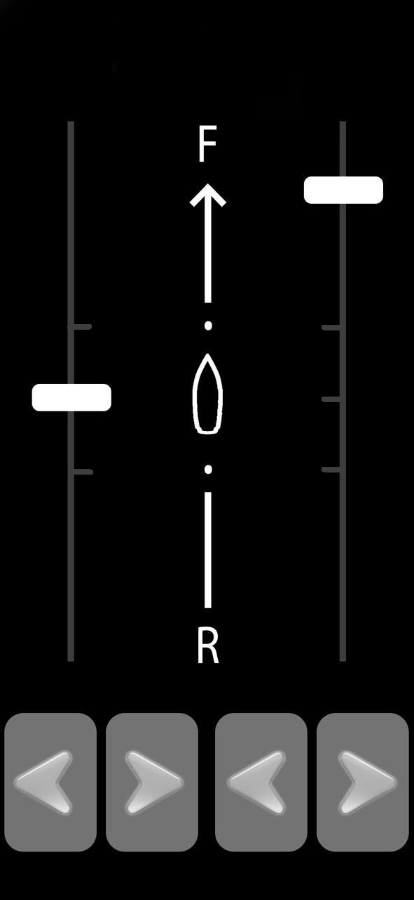
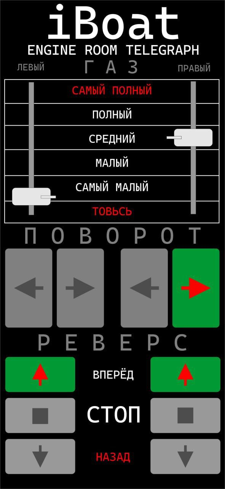

# Remote Control App «ARC126»

**Category:** Control posts  

Remote control of one or two motors from an Android device.

## Gallery

## Detailed description

An application that can be configured for the required number of motors, allowing you to control the motors: start, stop, throttle, reverse, turn.

Up to eight motors - optional

## Order and consultation

- [Write on Telegram](https://t.me/+79276867402)  
- [Write on WhatsApp](https://wa.me/+79276867402)  
- [Send email](mailto:1@vodoplav.ru)
