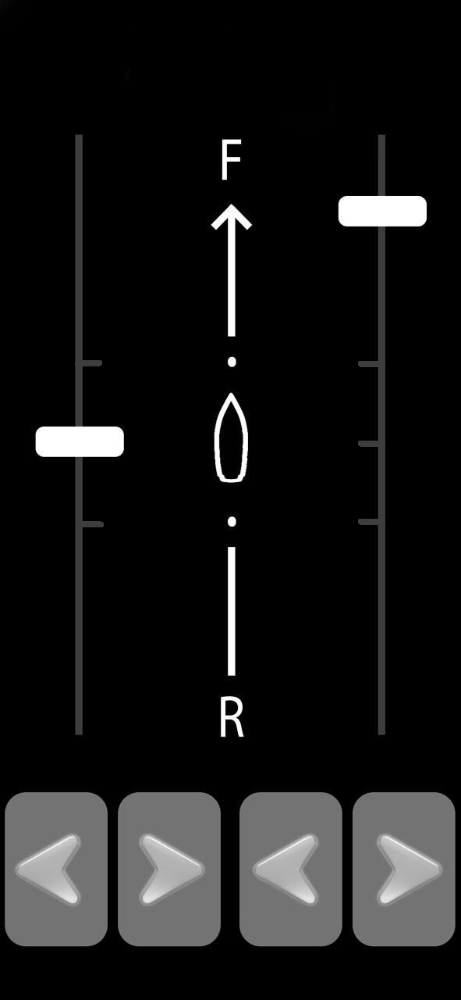
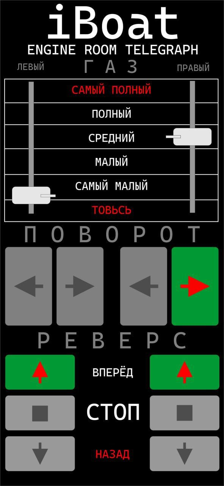

# Приложение Remote Control «ARC126»

**Категория:** Посты управления  

Дистанционное управление одним или двумя моторами с Android-устройства.

## Галерея

## Подробное описание

Настраиваемое под нужное количество моторов приложение, позволяющее управять моторами: пуск, останов, газ, реверс, поворот.

До восьми моторв - опционально

## Заказ и консультация

- [Написать в Telegram](https://t.me/+79276867402)  
- [Написать в WhatsApp](https://wa.me/+79276867402)  
- [Отправить email](mailto:1@vodoplav.ru)
