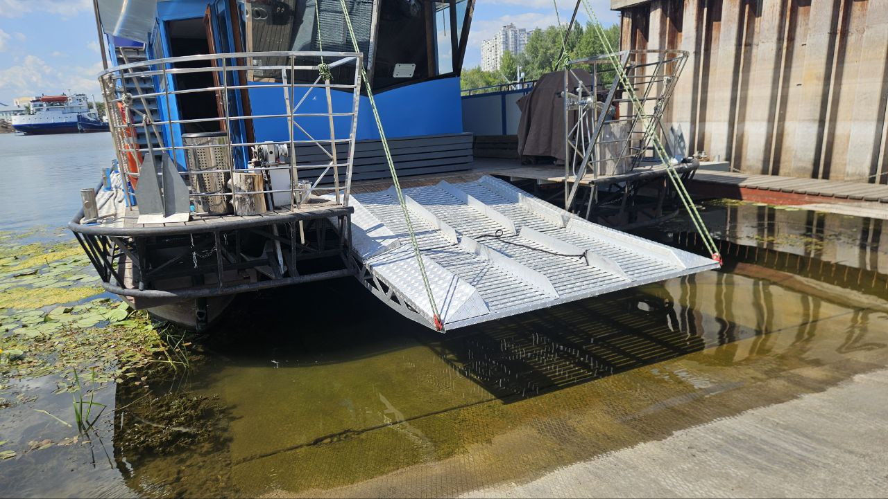
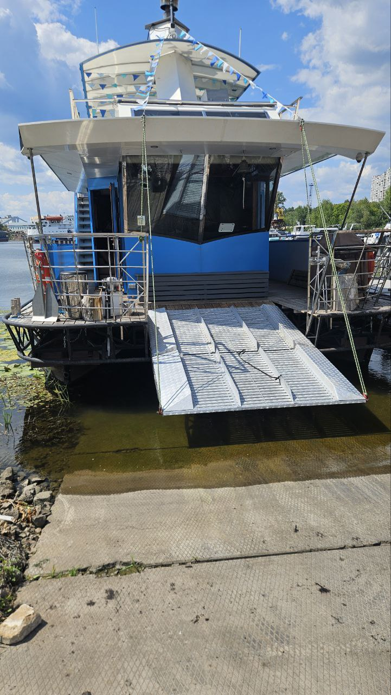
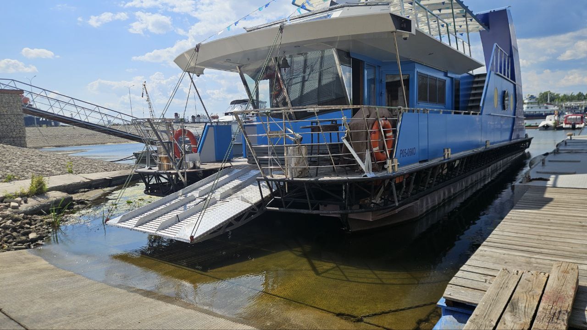
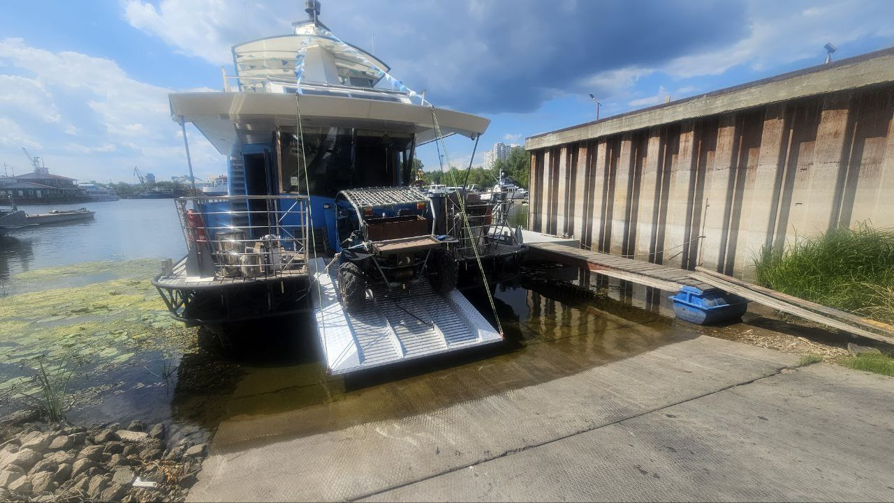
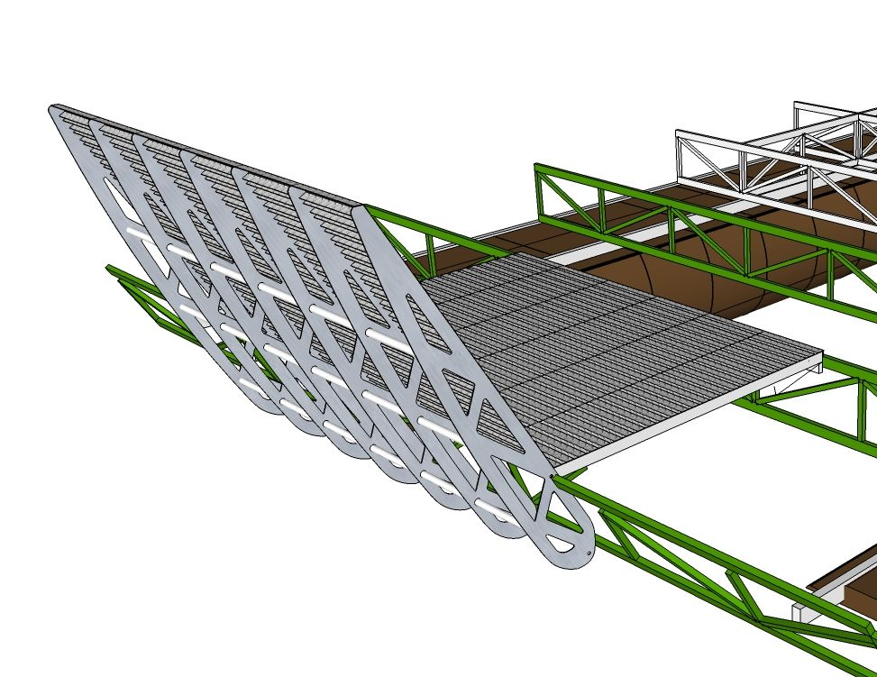
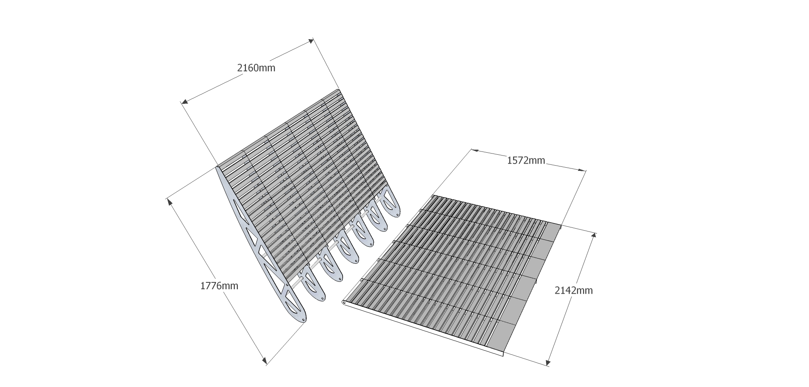
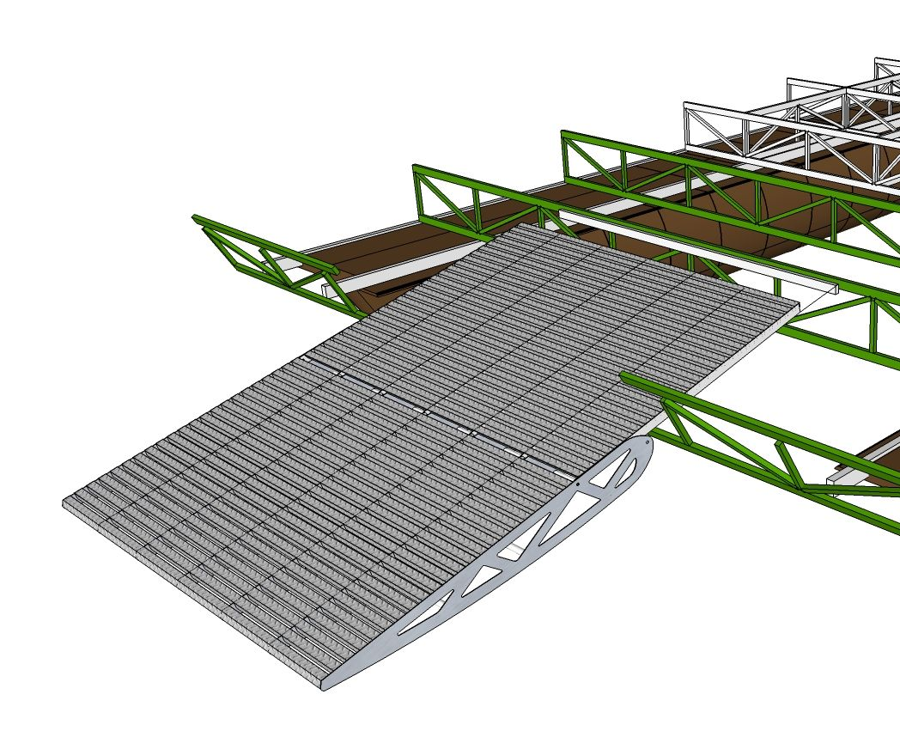

# Rampe «BA118»

**Kategorie:** Plattformen und Rampen  
**Preis:** 8.700 €

Eine zusammengesetzte Nasenplattform, die an Land oder Liegeplatz fällt

## Galerie

## Detaillierte Beschreibung

Zweiteilig. Die Länge beträgt 1.5+1.2 Meter. Die Breite beträgt 2,16 Meter. Das Mitnehmen beträgt 1,7 Meter. Die Absenkung vom Deckniveau beträgt 780 mm. Der Einstiegswinkel beträgt 15 Grad. Die Tragfähigkeit beträgt 800 kg. Für den bequemen Zugang zum unbebauten Ufer, für den Ein-/Ausstieg und den Transport von Fahrrädern, Quad-Fahrrädern.

## Bestellung und Beratung

- [Auf Telegram schreiben](https://t.me/+79276867402)  
- [Auf WhatsApp schreiben](https://wa.me/+79276867402)  
- [E-Mail senden](mailto:1@vodoplav.ru)
