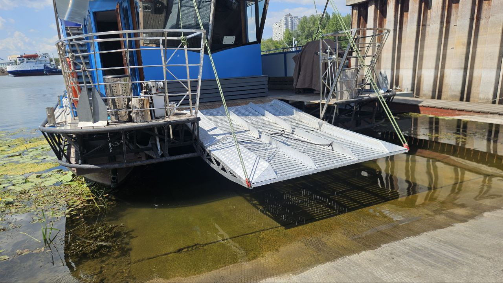
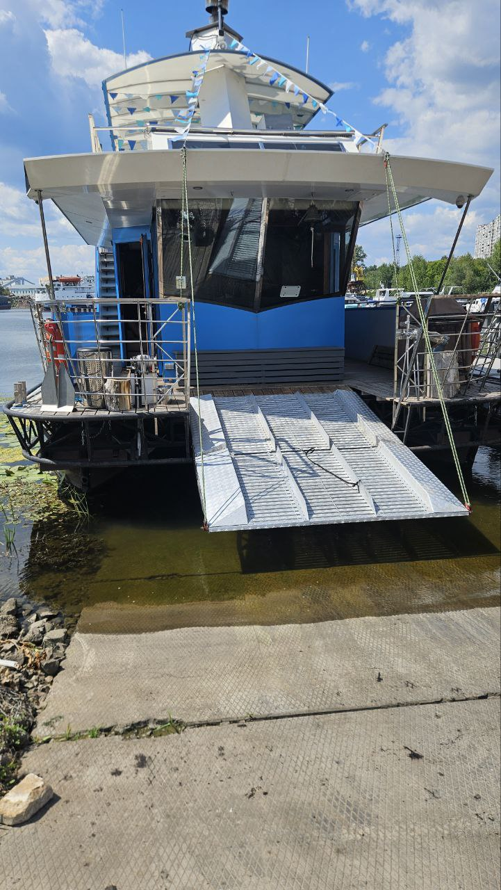
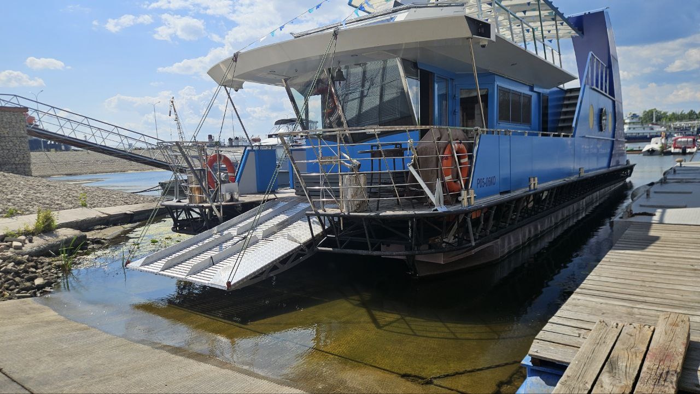
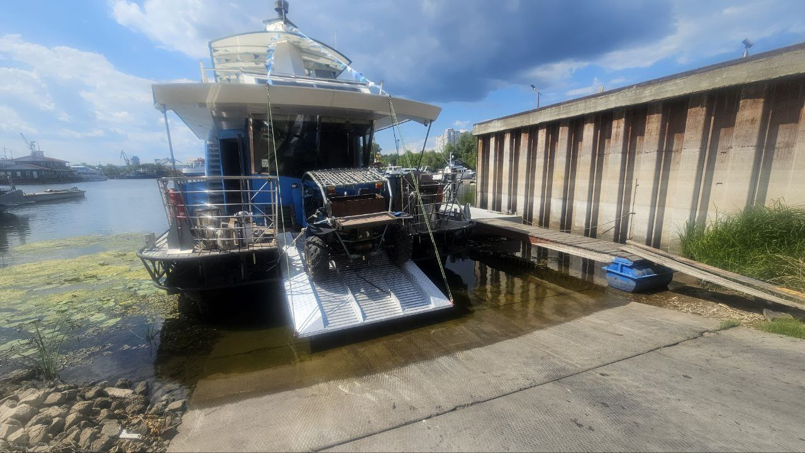
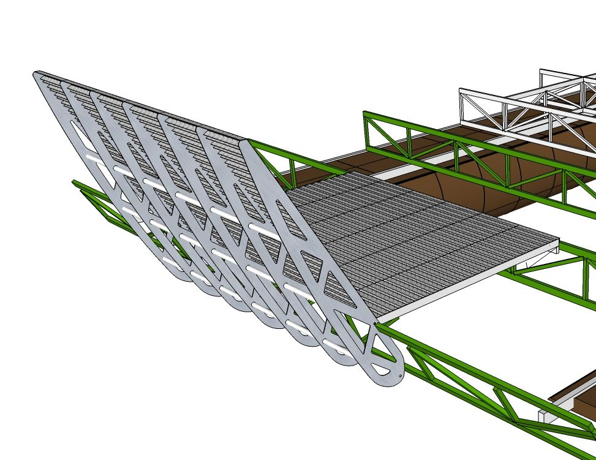
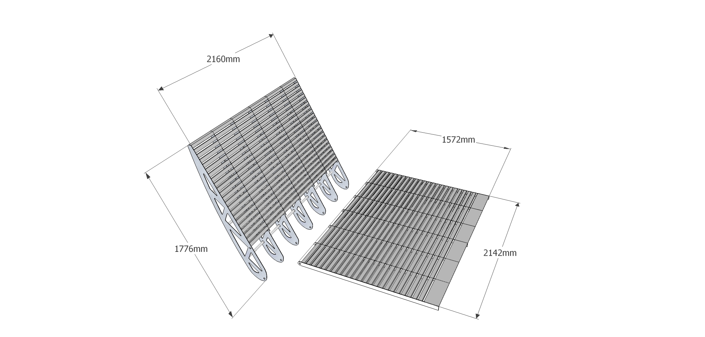
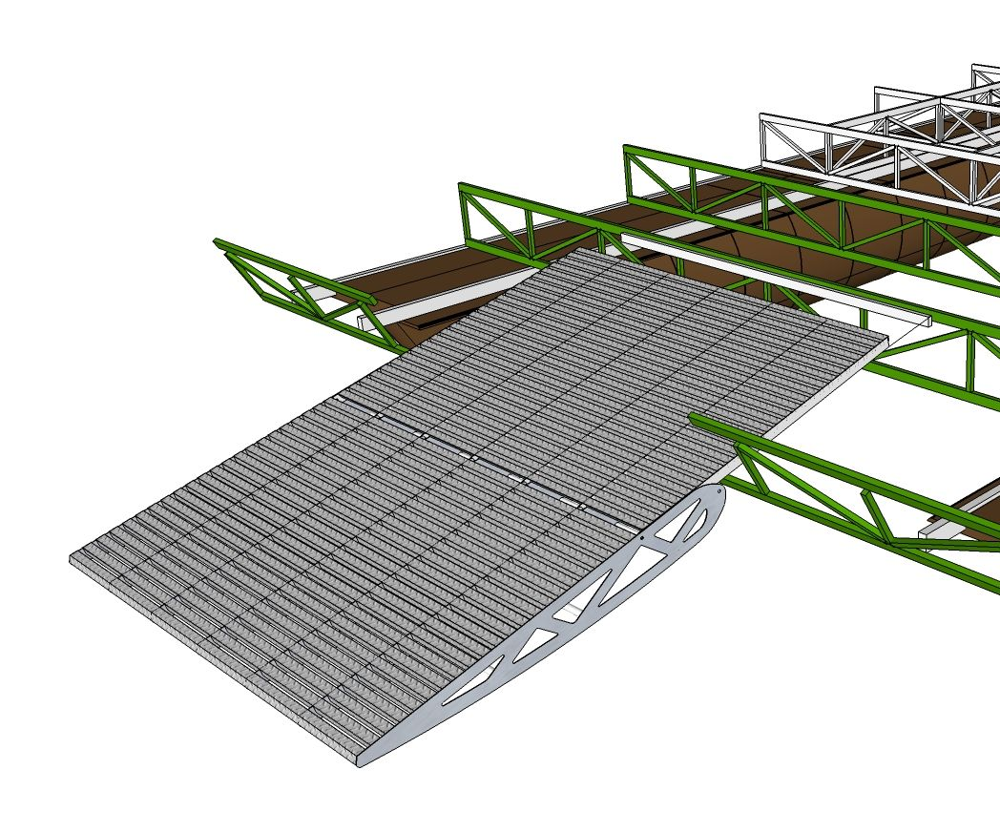

# Ramp «BA118»

**Category:** Platforms and gangways  
**Price:** $10,400

Composite bow platform that descends onto the shore or pier

## Gallery

## Detailed description

Two-part. The length is 1.5+1.2 meters. The width is 2.16 meters. The take-out is 1.7 meters. The descent from the deck level is 780 mm. The angle of entry is 15 degrees. Load capacity 800 kg. For convenient access to the unequipped shore, for entry/ exit and transportation of bicycles, quad bikes.

## Order and consultation

- [Write on Telegram](https://t.me/+79276867402)  
- [Write on WhatsApp](https://wa.me/+79276867402)  
- [Send email](mailto:1@vodoplav.ru)
