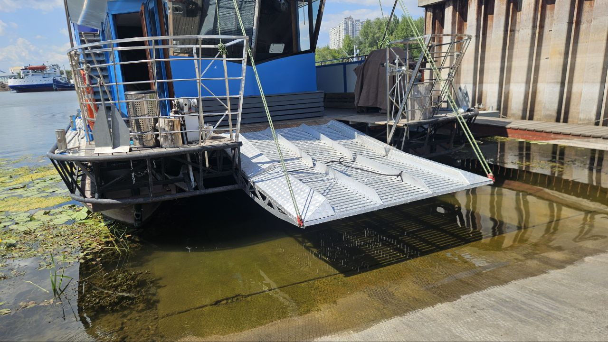
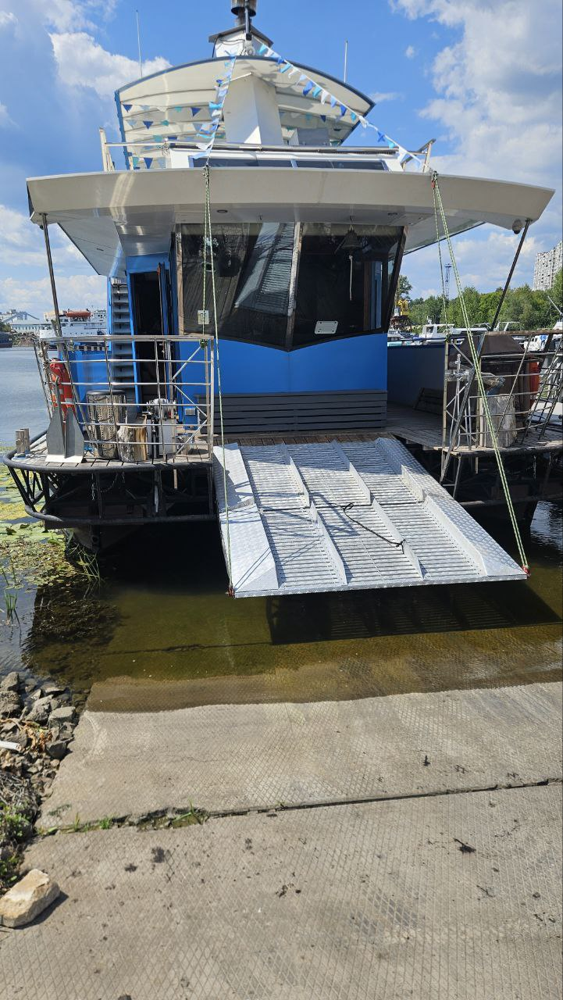
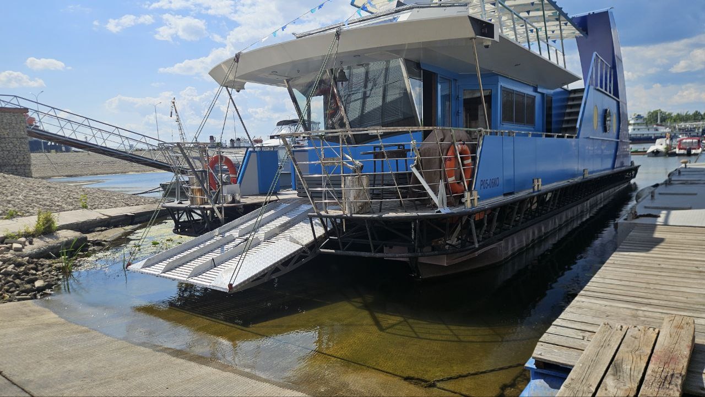
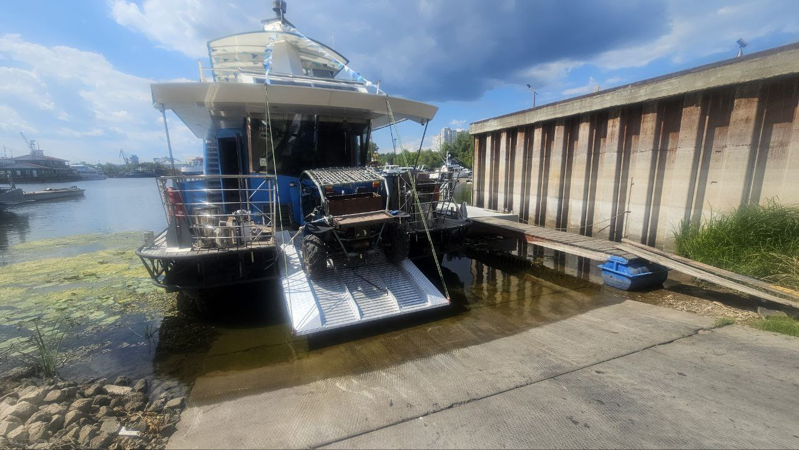
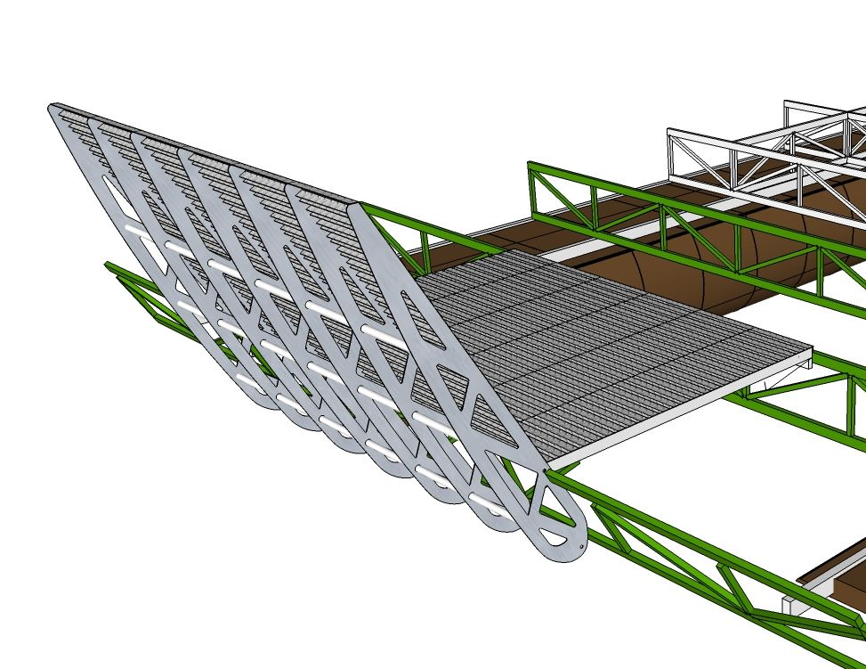
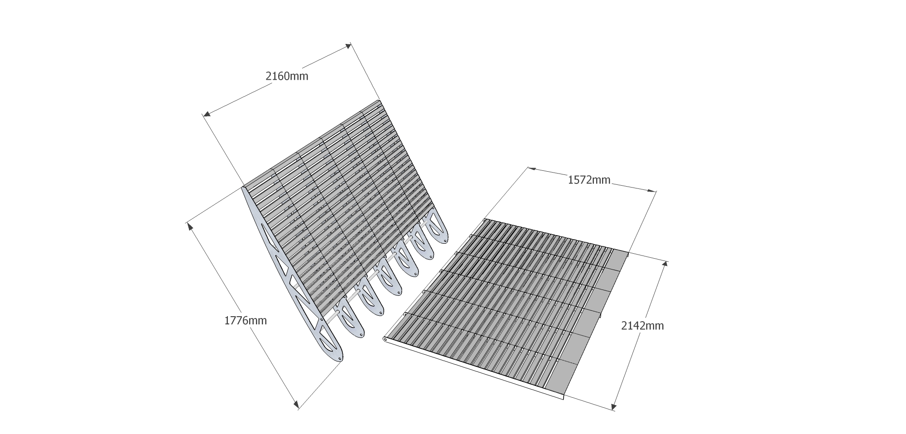
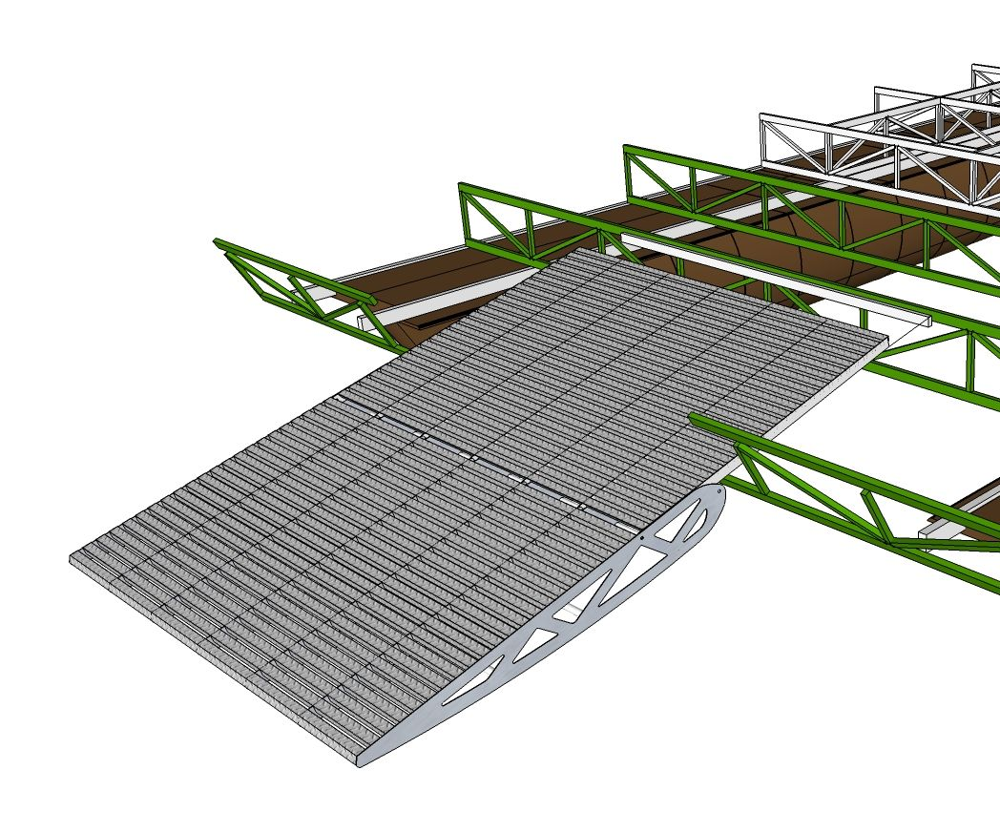

# Аппарель «BA118»

**Категория:** Платформы и аппарели  
**Цена:** 825 000 ₽

Составная носовая платформа, опускающаяся на берег или причал

## Галерея

## Подробное описание

Двухсоставная. Длина 1.5+1.2 метра. Ширина 2.16 метра. Вынос 1.7 метра. Опуск от уровня палубы 780 мм. Угол въезда 15 градусов. Грузоподъемность 800 кг. Для удобного схода на необорудованный берег, для заезда/съезда и транспортировки велосипедов, квадроцикла.

## Заказ и консультация

- [Написать в Telegram](https://t.me/+79276867402)  
- [Написать в WhatsApp](https://wa.me/+79276867402)  
- [Отправить email](mailto:1@vodoplav.ru)
