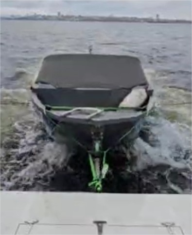

# BootStütz «BT121»

**Kategorie:** Zubehör  
**Preis:** 410 €

Ein Gerät zum sicheren Abschleppen des Bootes.

## Galerie

<video controls preload="metadata" style="max-width:100%"><source src="/img/BT121/01BT121.mp4" type="video/mp4"></video>

<video controls preload="metadata" style="max-width:100%"><source src="/img/BT121/02BT121.mp4" type="video/mp4"></video>

<video controls preload="metadata" style="max-width:100%"><source src="/img/BT121/03BT121.mp4" type="video/mp4"></video>

## Detaillierte Beschreibung

Mechanisches Liegeplatz-Dämpfergerät zum bequemen Abschleppen des Bootes/der Ausschreibung hinter der Yacht /dem Schwimmdock. Beschränkt die Manövrierbarkeit des Schiffes nicht - es ist möglich, anzumachen, zu manövrieren, rückwärts zu fahren. Stellt die notwendigen Züge und Rollen des abgeschleppten Bootes bei einer Wellenhöhe von bis zu 0,7 Metern bereit. Bietet ein bequemes Be-/Entladen, Ein- und Aussteigen von Passagieren.

## Bestellung und Beratung

- [Auf Telegram schreiben](https://t.me/+79276867402)  
- [Auf WhatsApp schreiben](https://wa.me/+79276867402)  
- [E-Mail senden](mailto:1@vodoplav.ru)
