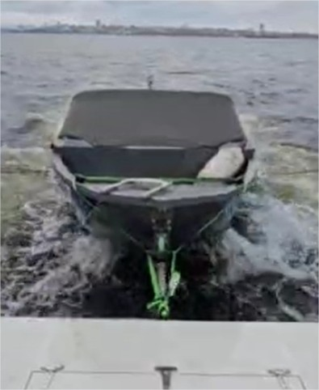

# BoatSupport «BT121»

**Category:** Accessories  
**Price:** $490

A device for safely towing a boat.

## Gallery

<video controls preload="metadata" style="max-width:100%"><source src="../img/BT121/01BT121.mp4" type="video/mp4"></video>

<video controls preload="metadata" style="max-width:100%"><source src="../img/BT121/02BT121.mp4" type="video/mp4"></video>

<video controls preload="metadata" style="max-width:100%"><source src="../img/BT121/03BT121.mp4" type="video/mp4"></video>

## Detailed description

Mechanical mooring and damping device for convenient towing of a boat/ tender behind a yacht/floating house. It does not limit the maneuverability of the vessel - mooring, maneuvering, and reversing are possible. Provides the necessary strokes and rolls of the towed boat at a wave height of up to 0.7 meters. Provides convenient loading/unloading, boarding/disembarking of passengers.

## Order and consultation

- [Write on Telegram](https://t.me/+79276867402)  
- [Write on WhatsApp](https://wa.me/+79276867402)  
- [Send email](mailto:1@vodoplav.ru)
