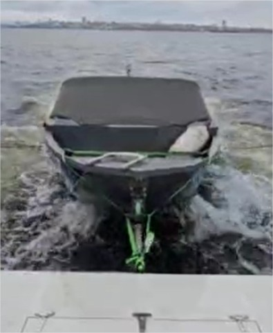

# Упор для буксировки лодки «BT121»

**Категория:** Аксессуары  
**Цена:** 38 500 ₽

Устройство для безопасной буксировки лодки.

## Галерея

[▶ Видео](../img/BT121/01BT121.mp4)

[▶ Видео](../img/BT121/02BT121.mp4)

[▶ Видео](../img/BT121/03BT121.mp4)

## Подробное описание

Механическое швартово-демпферное устройство для удобной буксировки лодки/тендера за яхтой/плавдомом. Не ограничивает маневренность судна - возможна швартовка, маневрирование, движение задним ходом. Обеспечивает необходимые ходы и крены буксируемой лодки при высоте волны до 0.7 метра. Обеспечивает удобную загрузку/выгрузку, посадку/высадку пассажиров.

## Заказ и консультация

- [Написать в Telegram](https://t.me/+79276867402)  
- [Написать в WhatsApp](https://wa.me/+79276867402)  
- [Отправить email](mailto:1@vodoplav.ru)
