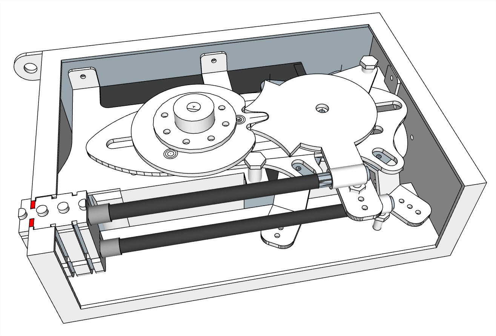
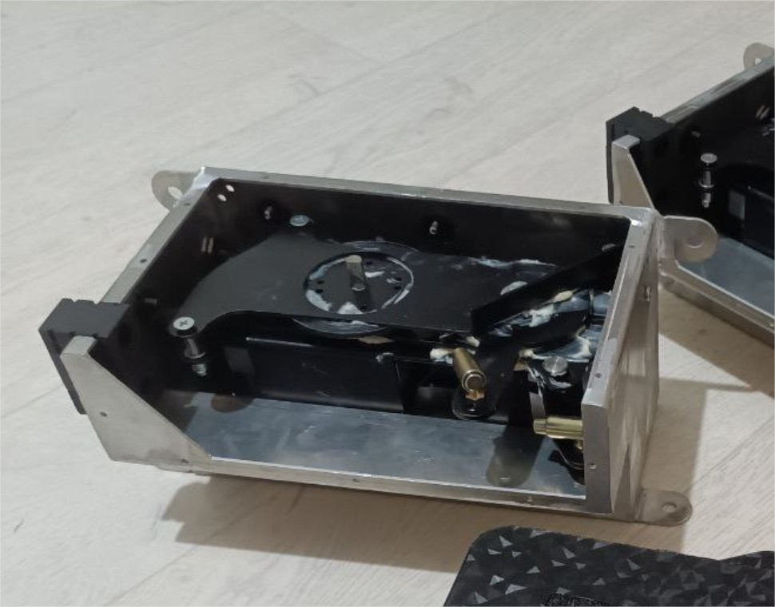
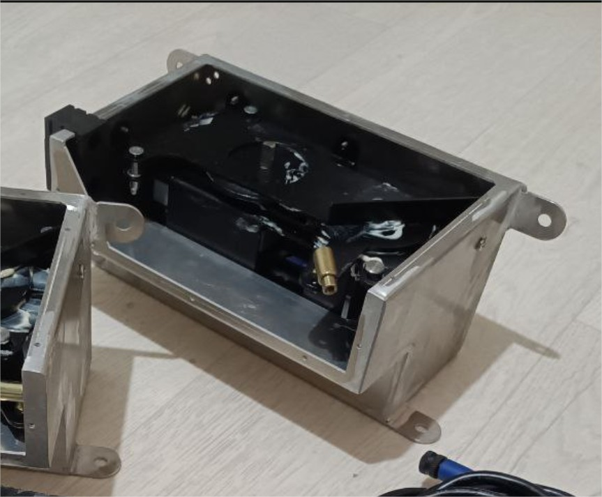
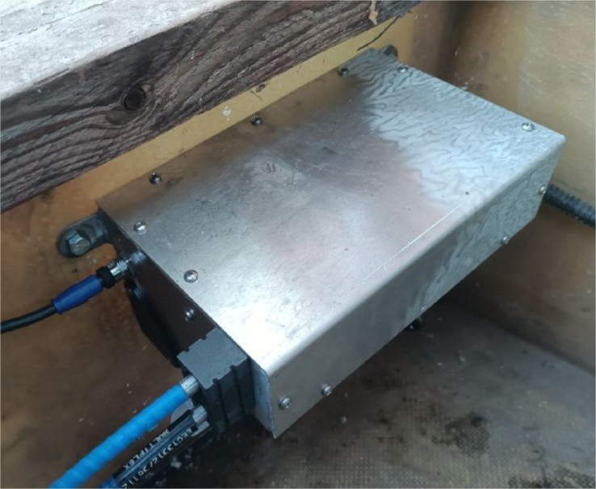

# Engine Control «EC325»

**Kategorie:** Motorsteuerung  
**Preis:** 2.300 €

Elektronisch-mechanisches Gerät zur Fernsteuerung des Gases und der Umkehrung eines hängenden oder stationären Motors. Die Fähigkeit, mehrere Kontrollposten zu verbinden. Position der Pfosten in jeder Entfernung von den Motoren.

## Galerie

<video controls preload="metadata" style="max-width:100%"><source src="/img/EC325/04EC325.mp4" type="video/mp4"></video>

## Detaillierte Beschreibung

Umfasst einen Controller und Servo, der gleichzeitig Stangen für Seilzüge Gas-und Schalthebel.

Zwei Ausführungen (Aluminium-Chassis oder Gehäuse 230х160х130мм)

Betriebsspannung 12 V

Dient der Steuerung der Gas-und Rückseite durch zwei typische Seilen C8.

Für die Verbindung mit ENG-HUB gilt typischen NMEA2000 Kabel. Verwenden Sie nicht Kabel einer Länge von über 5 Metern.

??Bei der Installation eines Motors kann in Verbindung mit den Remote Control direkt, ohne ENG-HUB-und STRG-Taste-HUB. In diesem Fall wird anstelle von ENG-HUB ein zusätzliches Netzteil installiert.??

Die Motorstartsperre bei eingeschaltetem Getriebe ist optional.

Die Servicesteuerung des Motors aus dem Gerätegehäuse (Zündung, Start- und Stopptasten) ist optional.

Die Wahl des Betriebsmodus des Motors (Drehzahlbereich für den vollen Hub des Postknopfes) ist optional.

Tempomat (Drehzahlverriegelung) ist optional.

Steuerung über Telefon/Tablet möglich - optional

## Bestellung und Beratung

- [Auf Telegram schreiben](https://t.me/+79276867402)  
- [Auf WhatsApp schreiben](https://wa.me/+79276867402)  
- [E-Mail senden](mailto:1@vodoplav.ru)
