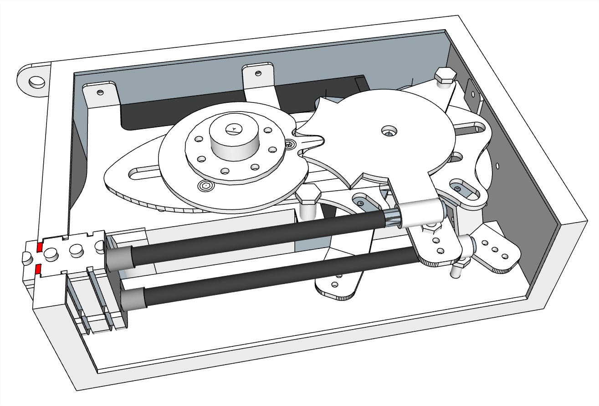
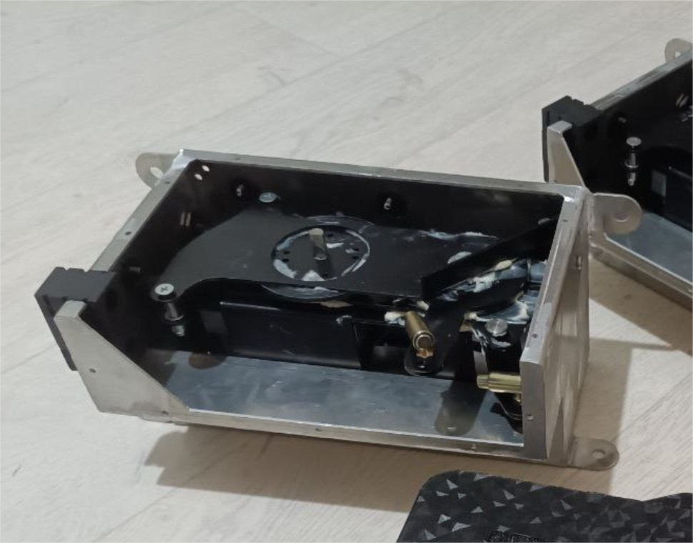
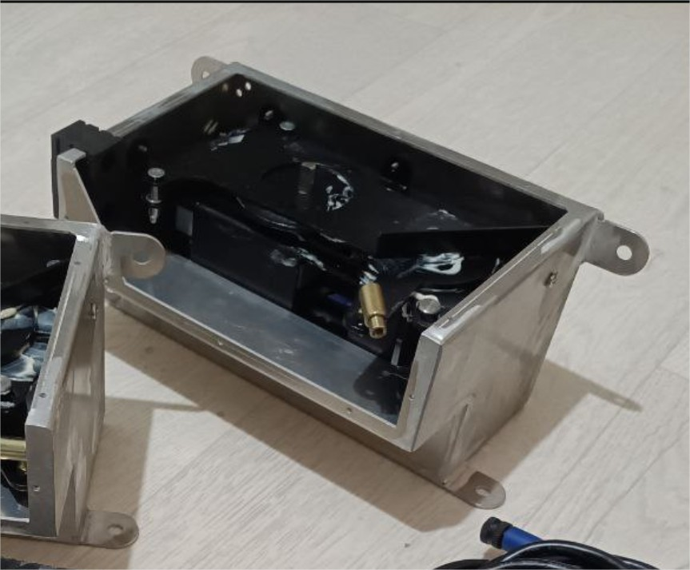
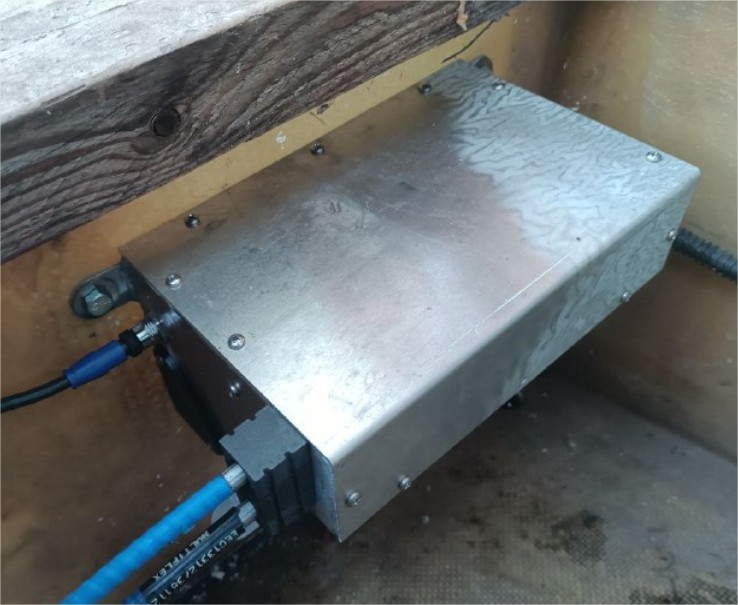

# Engine Control «EC325»

**Category:** Engine control  
**Price:** $2,750

An electronic-mechanical unit for remote control of the gas and reverse of an outboard or stationary motor. The ability to connect multiple control posts. The location of the posts at any distance from the engines.

## Gallery

<video controls preload="metadata" style="max-width:100%"><source src="/img/EC325/04EC325.mp4" type="video/mp4"></video>

## Detailed description

It includes a controller and a servo drive that simultaneously controls the rods for the throttle and reverse cables.

Two versions (chassis or aluminum housing 230x160x130mm)

The operating voltage is 12 V.

It is designed to control gas and reverse by means of two standard C8 cables.

A typical NMEA2000 cable is used to connect to the ENG-HUB. Do not use a cable longer than 5 meters.

??When installing a single motor, it is possible to connect to Remote Control directly, without the ENG-HUB and CTRL-HUB. In this case, an additional power supply unit is installed instead of the ENG-HUB.??

Blocking the engine start when the gear is switched on is optional.

Service control of the motor from the unit housing (ignition, "start" and "stop" buttons) is optional.

The choice of the operating mode of the motor (the speed range for the full stroke of the post handle) is optional.

Cruise control (speed control) is optional.

The ability to control from a phone/tablet is optional.

## Order and consultation

- [Write on Telegram](https://t.me/+79276867402)  
- [Write on WhatsApp](https://wa.me/+79276867402)  
- [Send email](mailto:1@vodoplav.ru)
