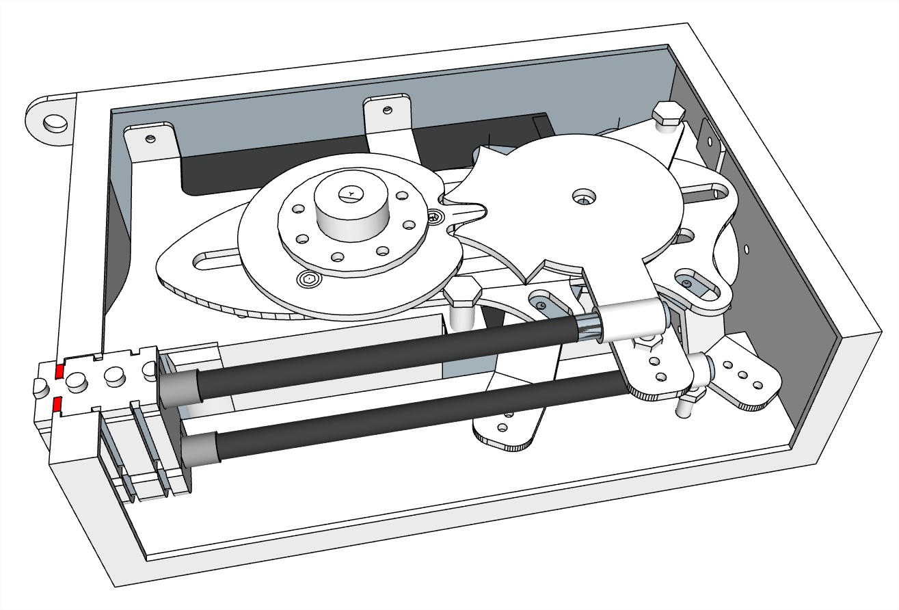
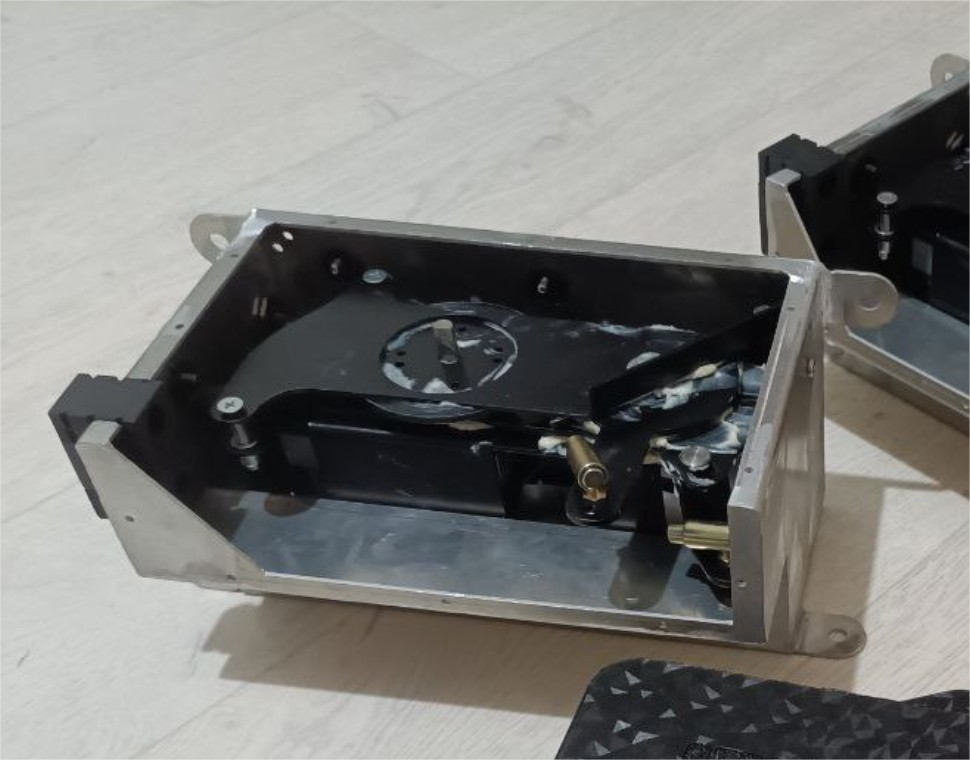
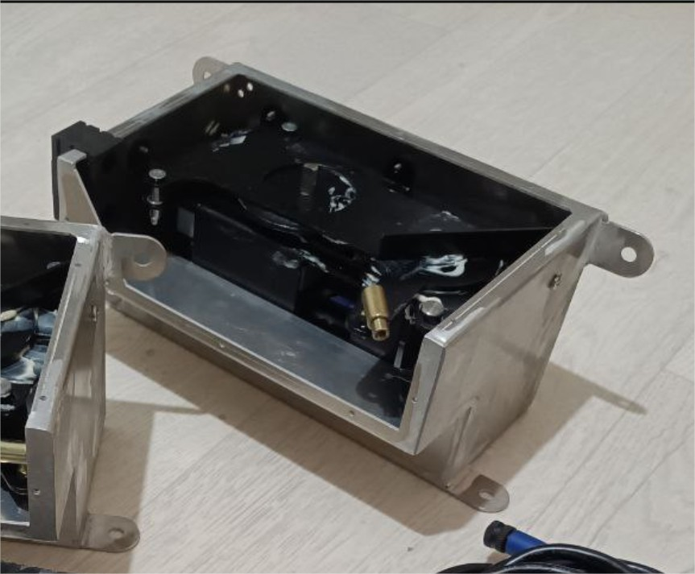
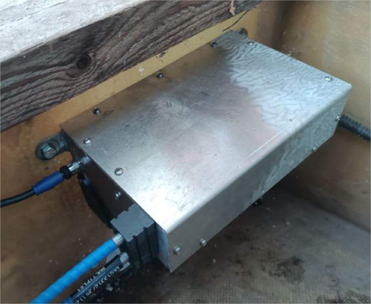

# Блок управления Engine Control «EC325»

**Категория:** Управление моторами  
**Цена:** 220 000 ₽

Электронно-механический блок для дистанционного управления газом и реверсом подвесного или стационарного мотора. Возможность подключения нескольких постов управления. Расположение постов на любом удалении от моторов.

## Галерея

<video controls preload="metadata" style="max-width:100%"><source src="/img/EC325/04EC325.mp4" type="video/mp4"></video>

## Подробное описание

Включает в себя контроллер и сервопривод, управляющий одновременно тягами для тросов газа и реверса.

Два варианта исполнения (шасси или алюминиевый корпус 230х160х130мм)

Рабочее напряжение 12 В.

Предназначен для управления газом и реверсом посредством двух типовых тросов С8.

Для соединения с ENG-HUB применяется типовой кабель NMEA2000. Не применять кабель длиной более 5 метров.

При установке одного мотора возможно соединение с Remote Control напрямую, без ENG-HUB и CTRL-HUB. В этом случае вместо ENG-HUB устанавливается дополнительный блок питания.

Блокировка запуска мотора при включенной передаче - опционально.

Сервисное управление мотором из корпуса блока (зажигание, кнопки "старт" и "стоп") - опционально.

Выбор режима работы мотора (диапазона оборотов на полный ход ручки поста) - опционально.

Круиз контроль (фиксация оборотов) - опционально.

Возможность управления с телефона/планшета - опционально

## Заказ и консультация

- [Написать в Telegram](https://t.me/+79276867402)  
- [Написать в WhatsApp](https://wa.me/+79276867402)  
- [Отправить email](mailto:1@vodoplav.ru)
