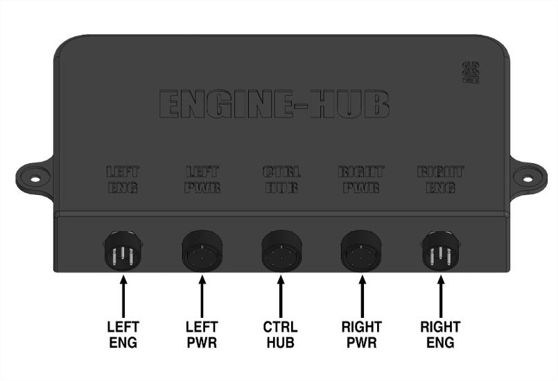
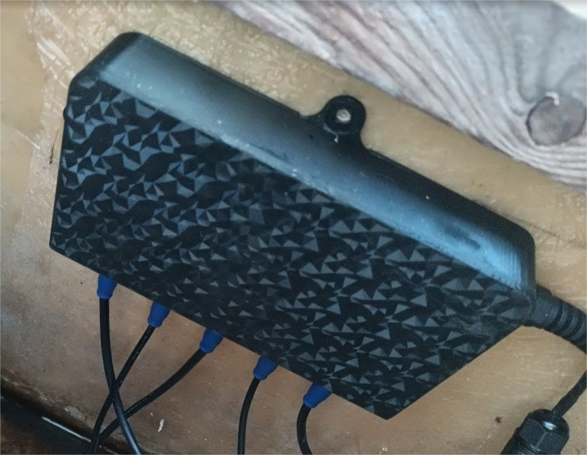
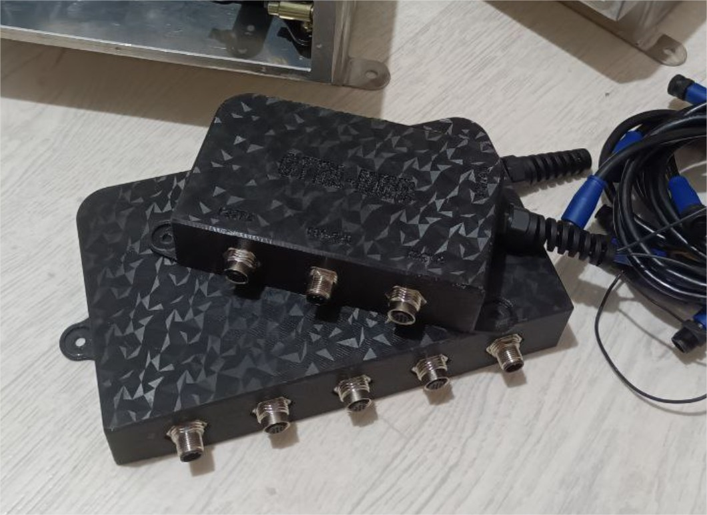

# Коммутатор моторов ENG-HUB «EH125»

**Категория:** Управление моторами  
**Цена:** 75 000 ₽

Коммутационный блок для организации управления двумя моторами

## Галерея

## Подробное описание

До восьми моторов - опционально

## Заказ и консультация

- [Написать в Telegram](https://t.me/+79276867402)  
- [Написать в WhatsApp](https://wa.me/+79276867402)  
- [Отправить email](mailto:1@vodoplav.ru)
