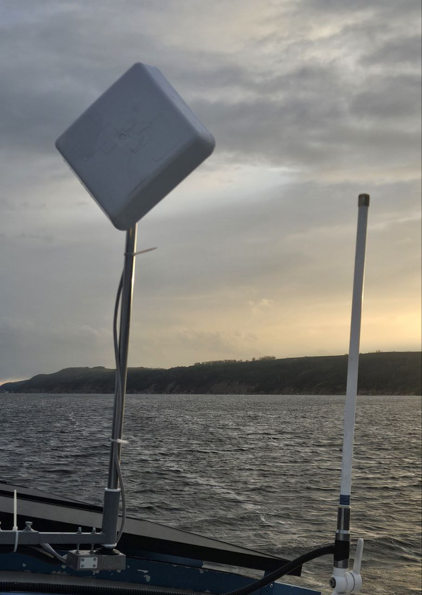

# Antenne «IA125»

**Kategorie:** Kommunikation und Internet  
**Preis:** 710 €

Richtungsgesteuertes Gerät. Bietet eine stabile Internetverbindung unter schwierigen Bedingungen.

## Galerie

[▶ Video](../img/IA125/01IA125.mp4)

## Detaillierte Beschreibung

Die Richtantenne (80 °) befindet sich auf einem motorisierten Mast mit einer 360 ° -Drehung. Die Drehsteuerung ist drahtlos per Fernbedienung. Die Versorgungsspannung beträgt 12V. Im Lieferumfang enthalten ist ein Router, eine SIM-Karte.

## Bestellung und Beratung

- [Auf Telegram schreiben](https://t.me/+79276867402)  
- [Auf WhatsApp schreiben](https://wa.me/+79276867402)  
- [E-Mail senden](mailto:1@vodoplav.ru)
