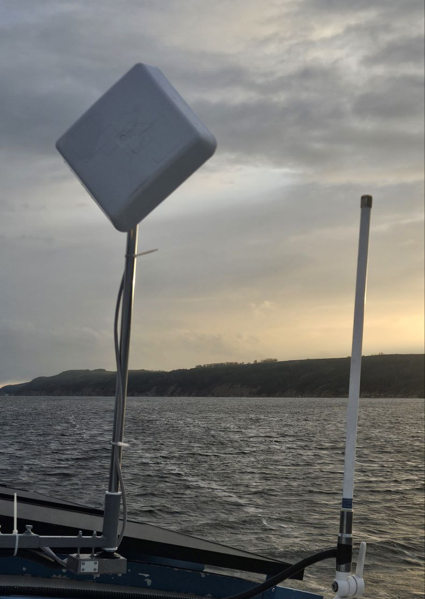

# Antenna «IA125»

**Category:** Communication and internet  
**Price:** $850

A directional device. Provides a stable internet connection in difficult conditions.

## Gallery

[▶ Video](../img/IA125/01IA125.mp4)

## Detailed description

The directional antenna (80⁰) is mounted on a motorized mast with 360⁰ rotation. Turn control is a wireless remote control. The supply voltage is 12V. A router and a SIM card are included in the package.

## Order and consultation

- [Write on Telegram](https://t.me/+79276867402)  
- [Write on WhatsApp](https://wa.me/+79276867402)  
- [Send email](mailto:1@vodoplav.ru)
