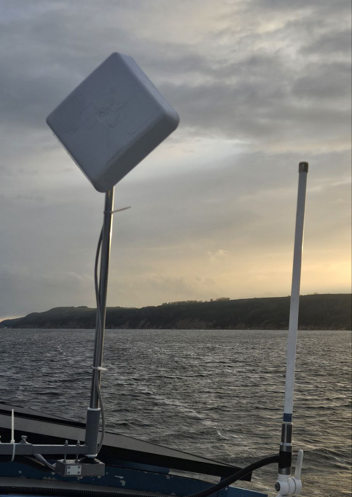

# Адаптивная управляемая интернет-антенна «IA125»

**Категория:** Связь и интернет  
**Цена:** 67 300 ₽

Устройство направленного действия. Обеспечивает устойчивое интернет-соединение в сложных условиях.

## Галерея

[▶ Видео](../img/IA125/01IA125.mp4)

## Подробное описание

Антенна направленного действия (80⁰) размещена на моторизиванной мачте с поворотом 360⁰. Управление поворотом - беспроводное дистанционное. Напряжение питания 12В. В комплекте поставки роутер, сим-карта.

## Заказ и консультация

- [Написать в Telegram](https://t.me/+79276867402)  
- [Написать в WhatsApp](https://wa.me/+79276867402)  
- [Отправить email](mailto:1@vodoplav.ru)
