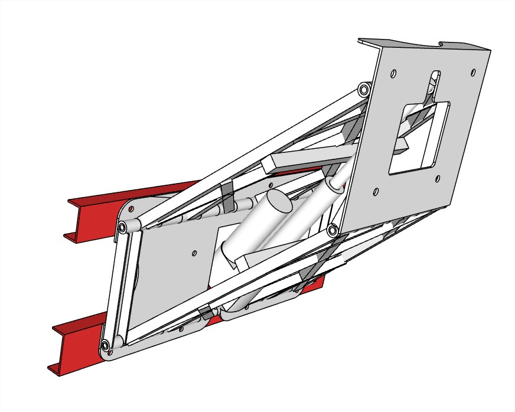
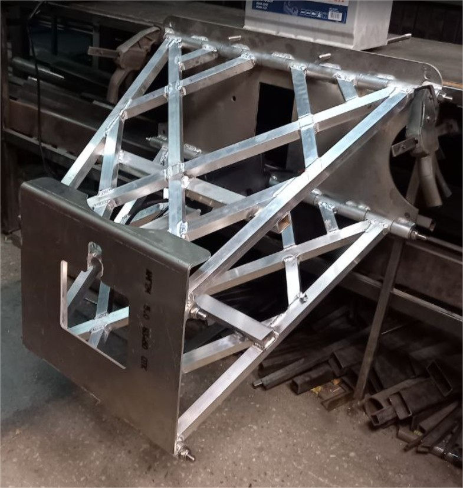

# Motor Lift «ML324»

**Kategorie:** Motorsteuerung  
**Preis:** 2.900 €

Elektrisch verstellbarer Heck zur Höhenverstellung des Außenbordmotors.

## Galerie

<video controls preload="metadata" style="max-width:100%"><source src="../img/ML324/02ML324.mp4" type="video/mp4"></video>

## Detaillierte Beschreibung

Der Heck dient zur Höhenverstellung des Außenbordmotors während des Laufens und zum vollständigen Anheben des Motors aus dem Wasser zur Wartung und Konservierung.

Betriebsspannung 12 V

Die Hubhöhe beträgt 680 mm.

Gewicht 23.4 kg.

Die Tragfähigkeit beträgt 250 kg.

Die zulässige Motorleistung beträgt 80 PS.

## Bestellung und Beratung

- [Auf Telegram schreiben](https://t.me/+79276867402)  
- [Auf WhatsApp schreiben](https://wa.me/+79276867402)  
- [E-Mail senden](mailto:1@vodoplav.ru)
