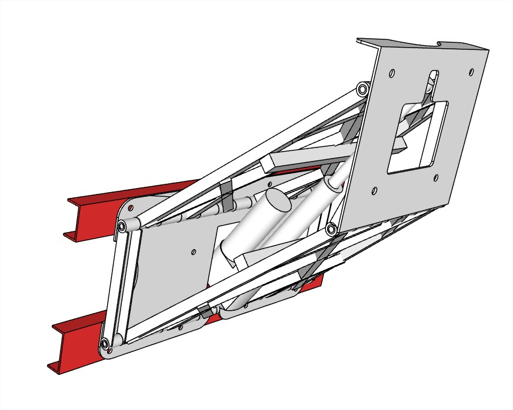
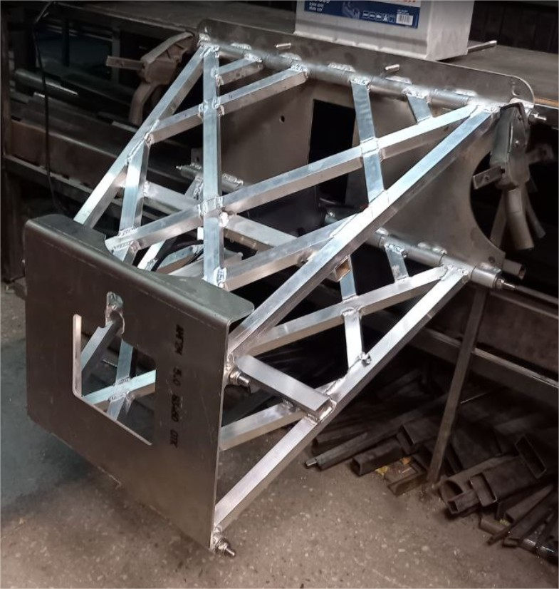

# Motor Lift «ML324»

**Category:** Engine control  
**Price:** $3,500

A transom with an electric drive for adjusting the height of the outboard motor.

## Gallery

<video controls preload="metadata" style="max-width:100%"><source src="../img/ML324/02ML324.mp4" type="video/mp4"></video>

## Detailed description

The transom is designed to adjust the height of the outboard motor on the move and to fully lift the motor out of the water for maintenance and preservation.

The operating voltage is 12 V.

Stroke height is 680 mm.

Weight 23.4 kg.

Load capacity 250 kg.

The permissible engine power is 80 hp.

## Order and consultation

- [Write on Telegram](https://t.me/+79276867402)  
- [Write on WhatsApp](https://wa.me/+79276867402)  
- [Send email](mailto:1@vodoplav.ru)
