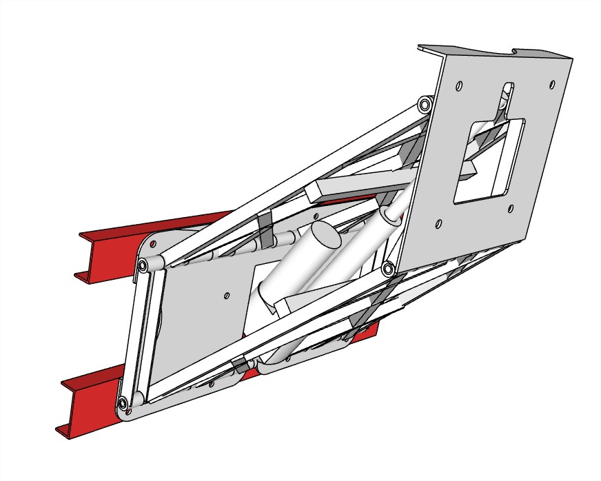
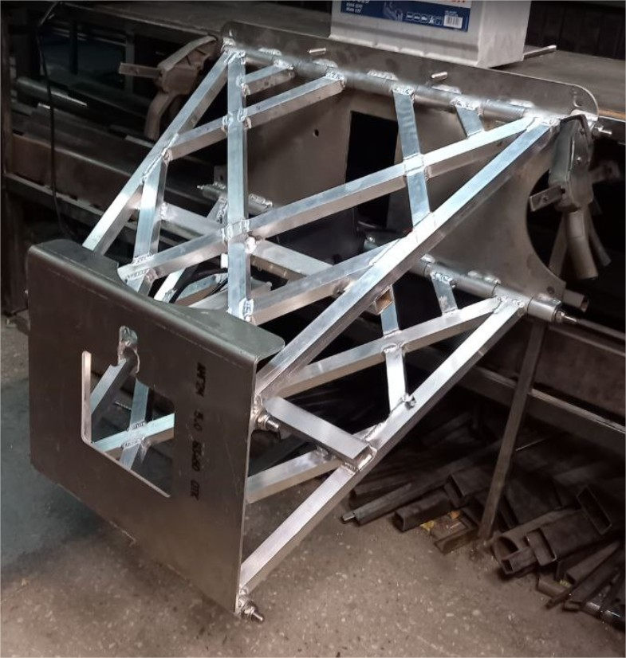

# Регулируемый транец (подъемник мотора) (лифт мотора) «ML324»

**Категория:** Управление моторами  
**Цена:** 275 000 ₽

Транец с электроприводом для регулировки высоты положения подвесного лодочного мотора.

## Галерея

<video controls preload="metadata" style="max-width:100%"><source src="/img/ML324/02ML324.mp4" type="video/mp4"></video>

## Подробное описание

Транец предназначен для регулировки высоты положения подвесного лодочного мотора на ходу и для полного подъема мотора из воды для обслуживания и консервации.

Рабочее напряжение 12 В.

Высота хода 680 мм.

Вес 23.4 кг.

Грузоподъемность 250 кг.

Допустимая мощность мотора 80 л.с.

## Заказ и консультация

- [Написать в Telegram](https://t.me/+79276867402)  
- [Написать в WhatsApp](https://wa.me/+79276867402)  
- [Отправить email](mailto:1@vodoplav.ru)
