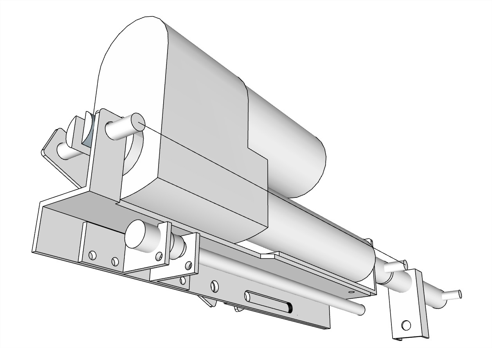
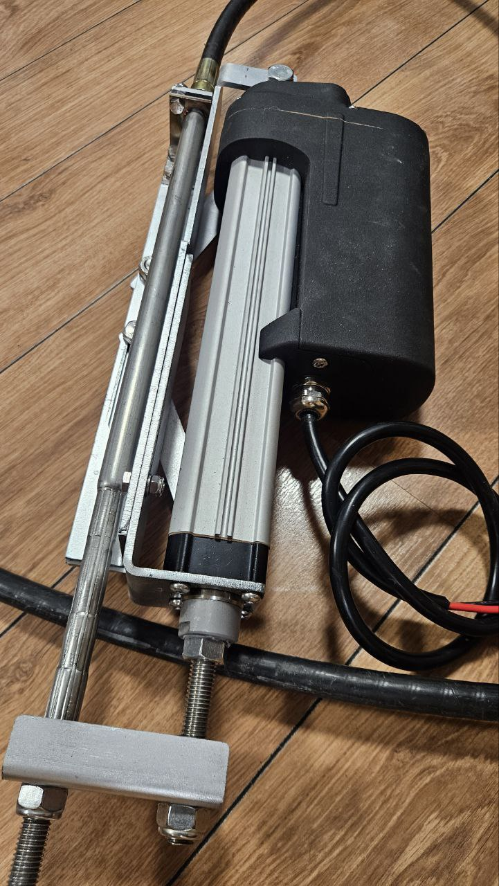
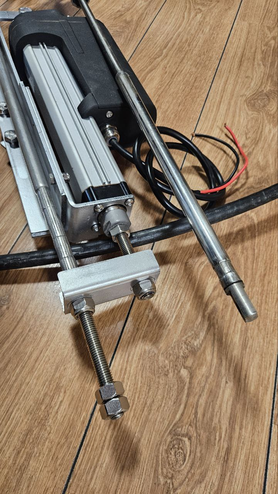
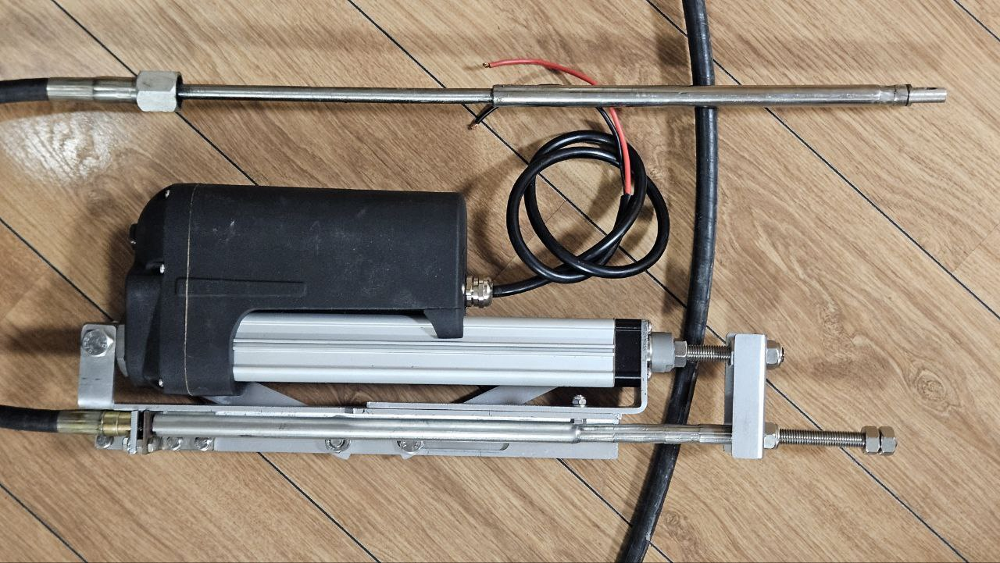
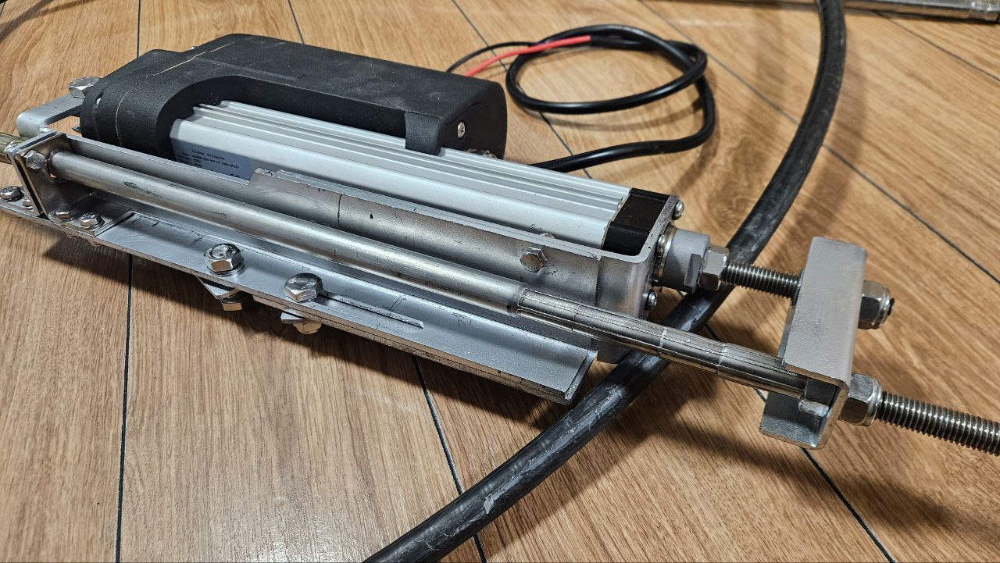
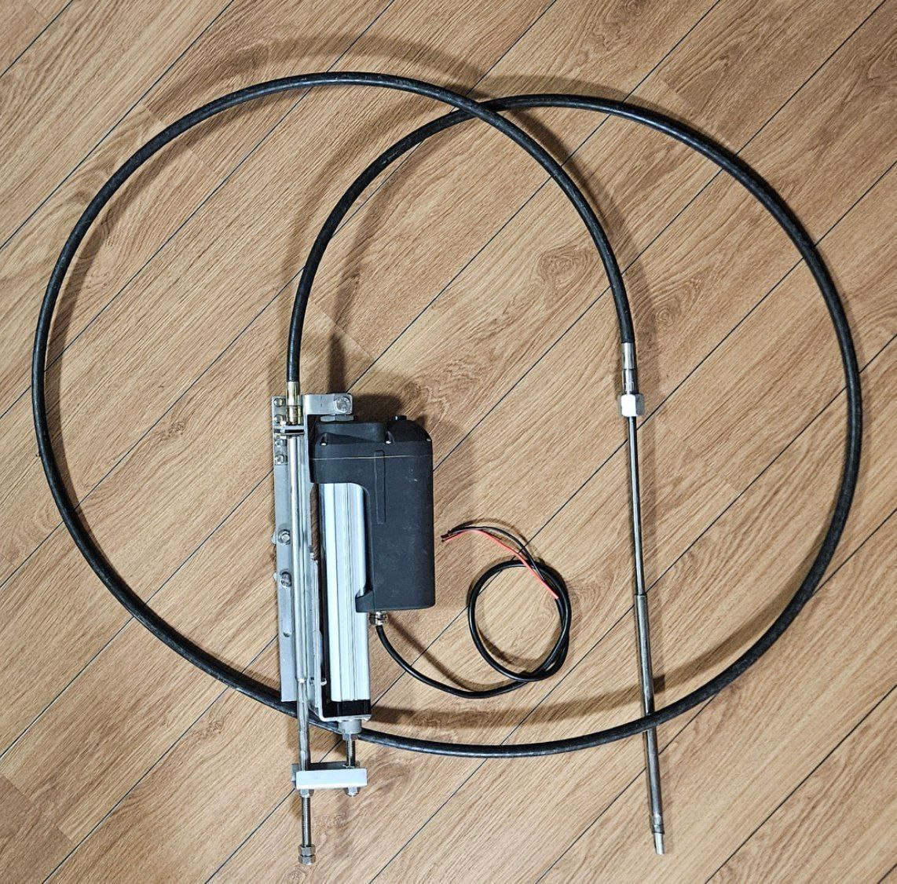
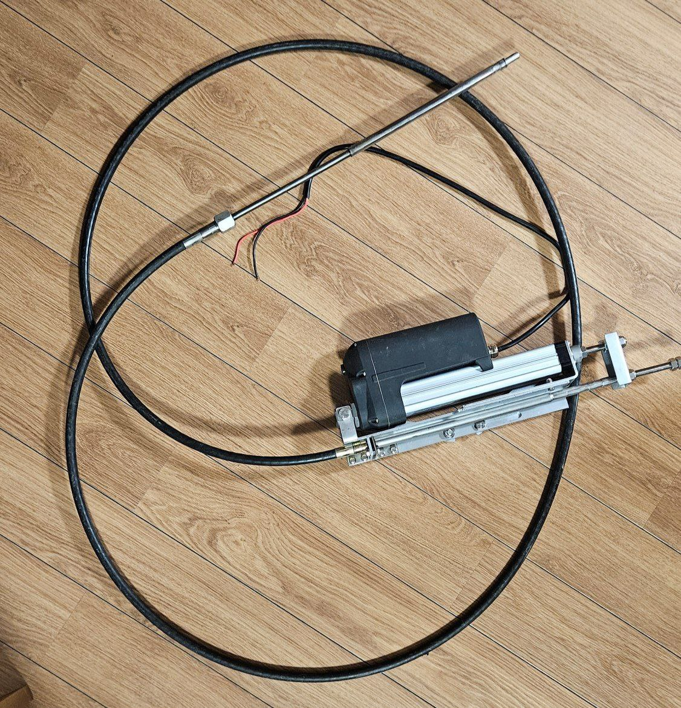

# Motor Turn «MT425»

**Kategorie:** Motorsteuerung  
**Preis:** 3.000 €

Elektronisch-mechanisches Gerät zur Fernsteuerung der Drehung. Die Fähigkeit, mehrere Kontrollposten zu verbinden. Position der Pfosten in jeder Entfernung vom Motor.

## Galerie

## Detaillierte Beschreibung

Ermöglicht die Fernsteuerung der Drehung eines Außenbordmotors mit einer Leistung von bis zu 115 PS. Enthält einen elektrischen Zylinder, der die Drehung des Außenbordmotors über das typische Lenkseil M66 steuert. Betriebsspannung 12 V

## Bestellung und Beratung

- [Auf Telegram schreiben](https://t.me/+79276867402)  
- [Auf WhatsApp schreiben](https://wa.me/+79276867402)  
- [E-Mail senden](mailto:1@vodoplav.ru)
