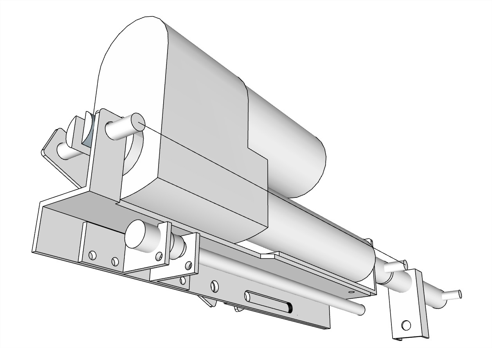
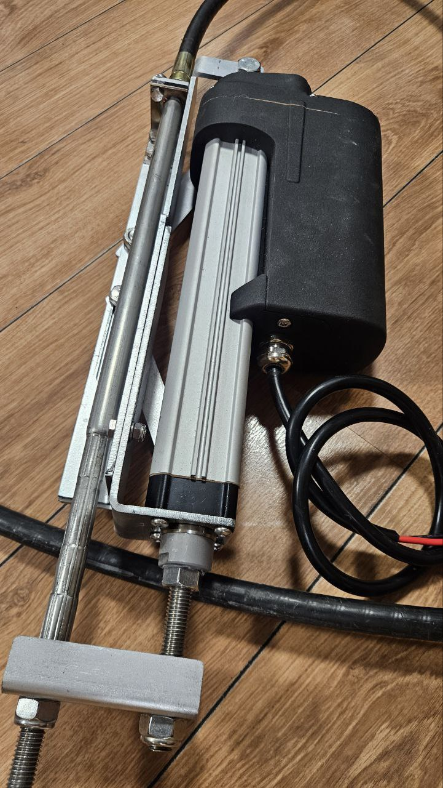
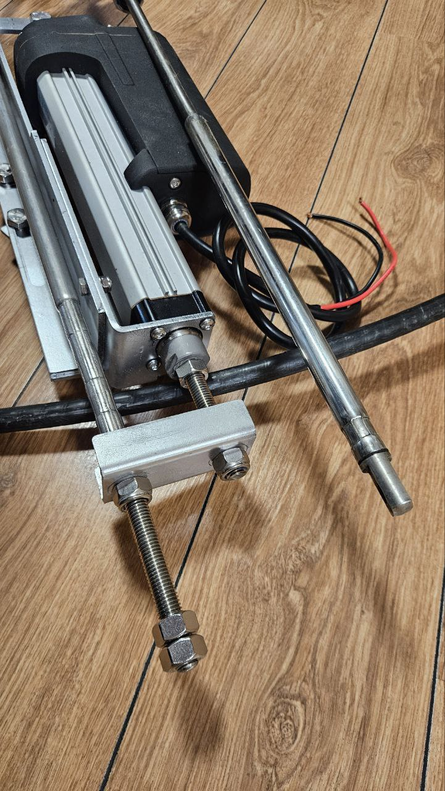
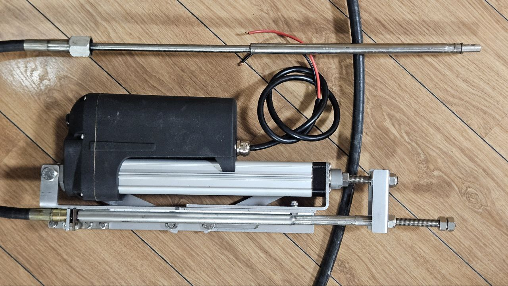
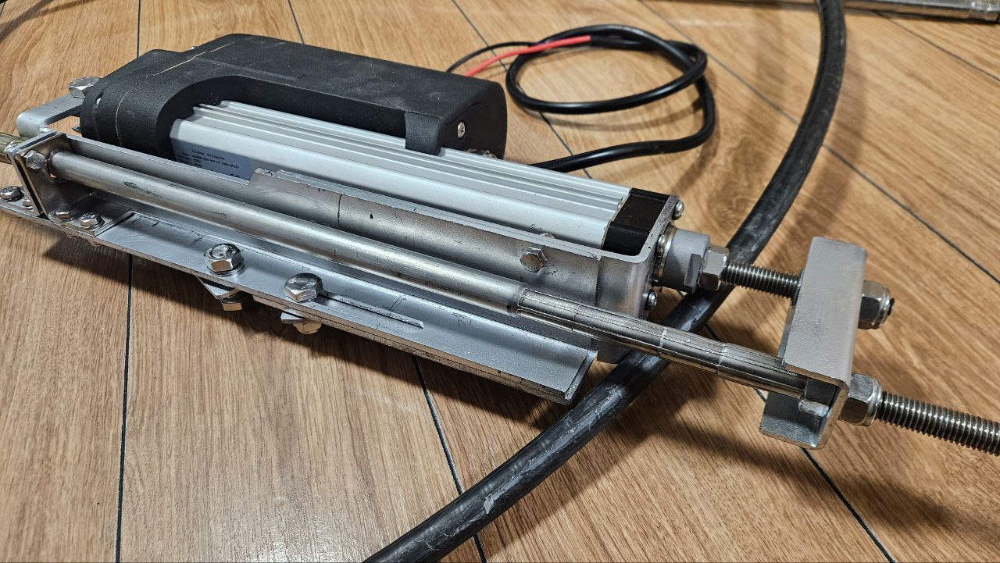
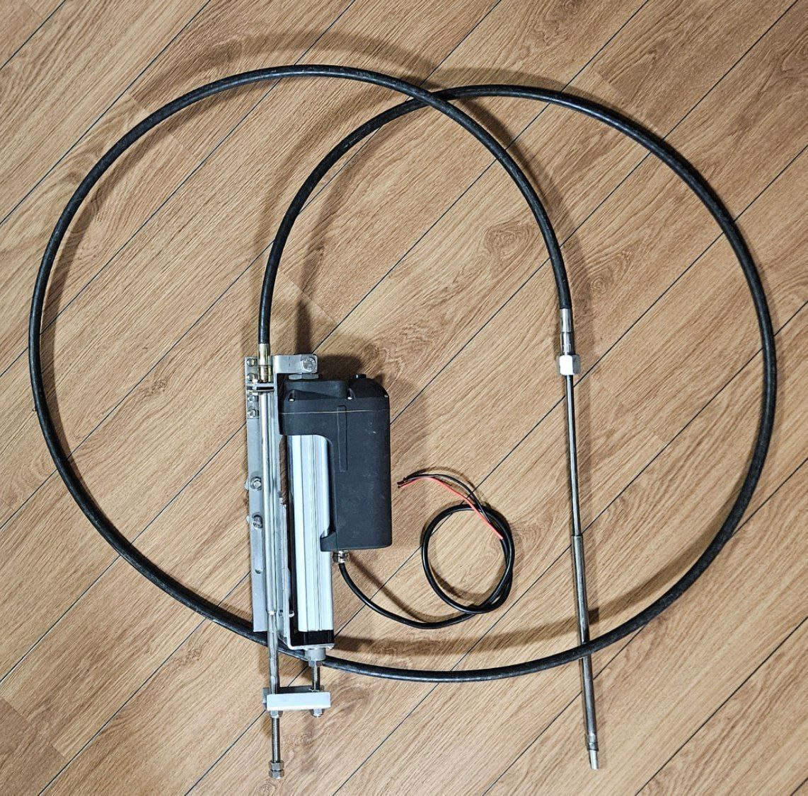
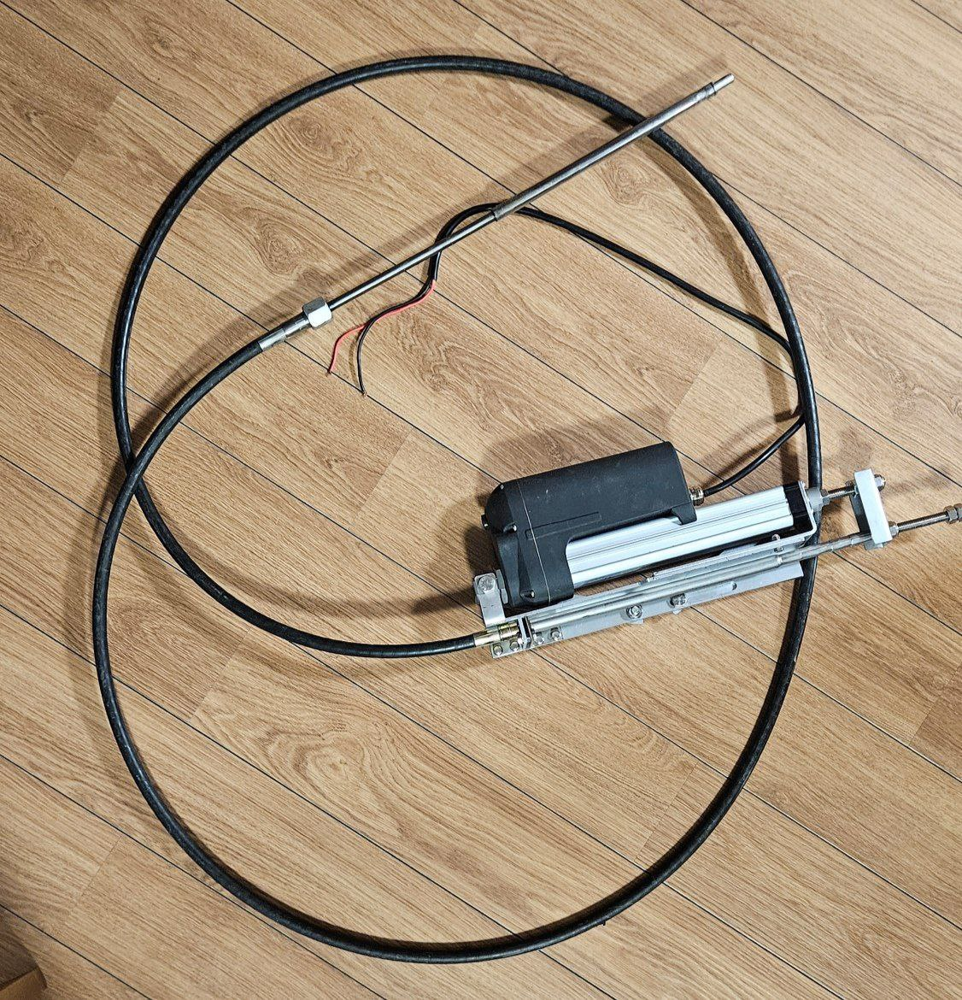

# Motor Turn «MT425»

**Category:** Engine control  
**Price:** $3,600

An electronic-mechanical unit for remote control of the turn. The ability to connect multiple control posts. The location of the posts at any distance from the engine.

## Gallery

## Detailed description

It allows you to remotely control the rotation of an outboard boat motor with a power of up to 115 hp. It is possible to control a swing-out column, a steering wheel pen. It includes an electric cylinder that controls the rotation of an outboard boat motor through a standard M66 steering cable. The operating voltage is 12 V.

## Order and consultation

- [Write on Telegram](https://t.me/+79276867402)  
- [Write on WhatsApp](https://wa.me/+79276867402)  
- [Send email](mailto:1@vodoplav.ru)
