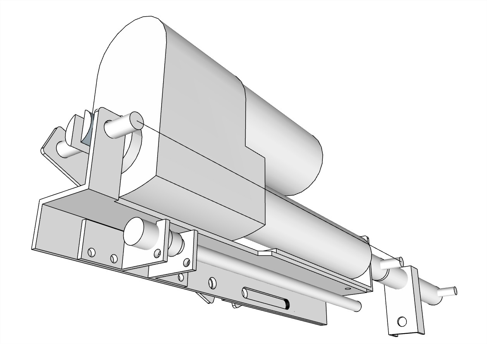
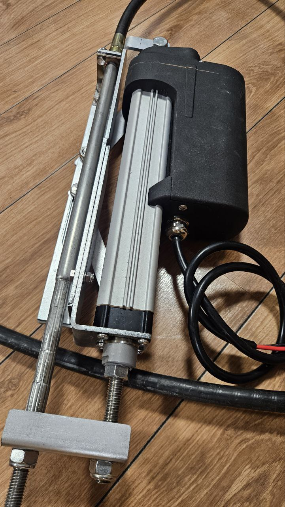
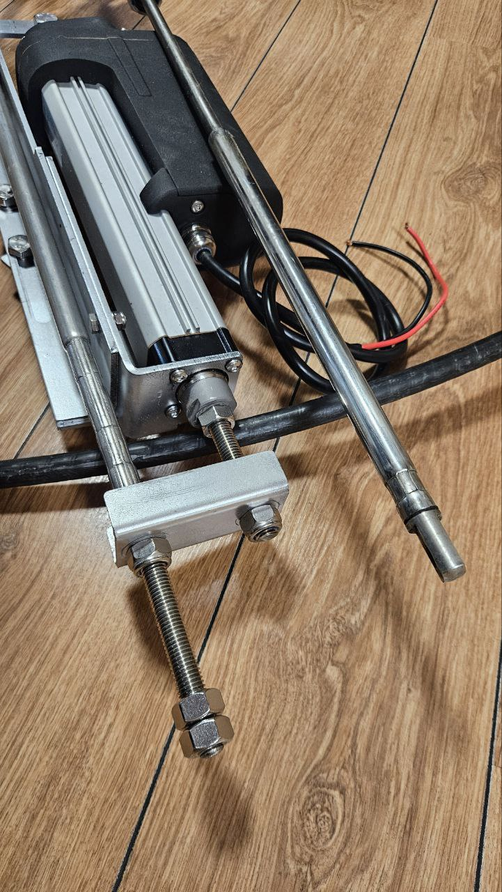
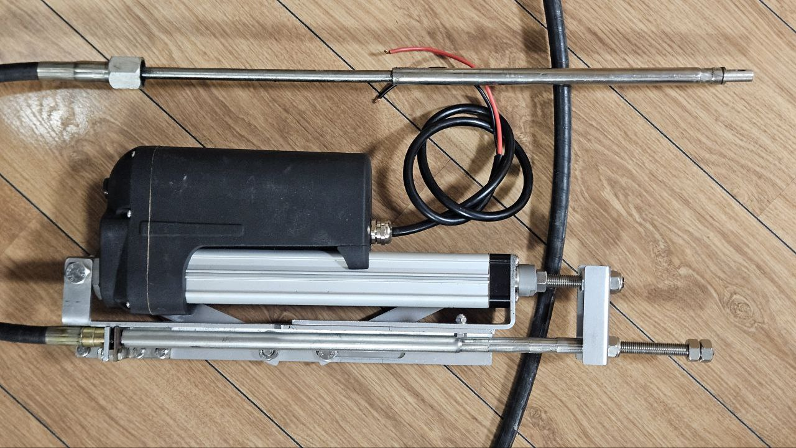
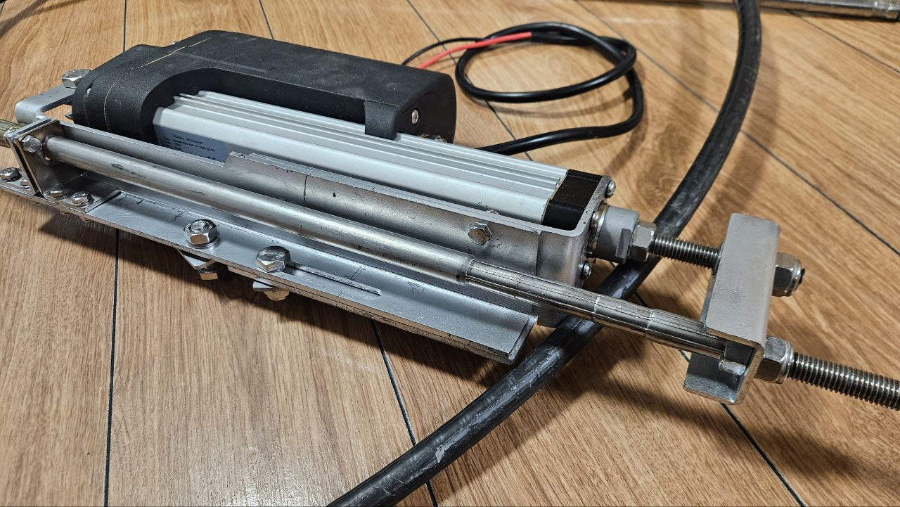
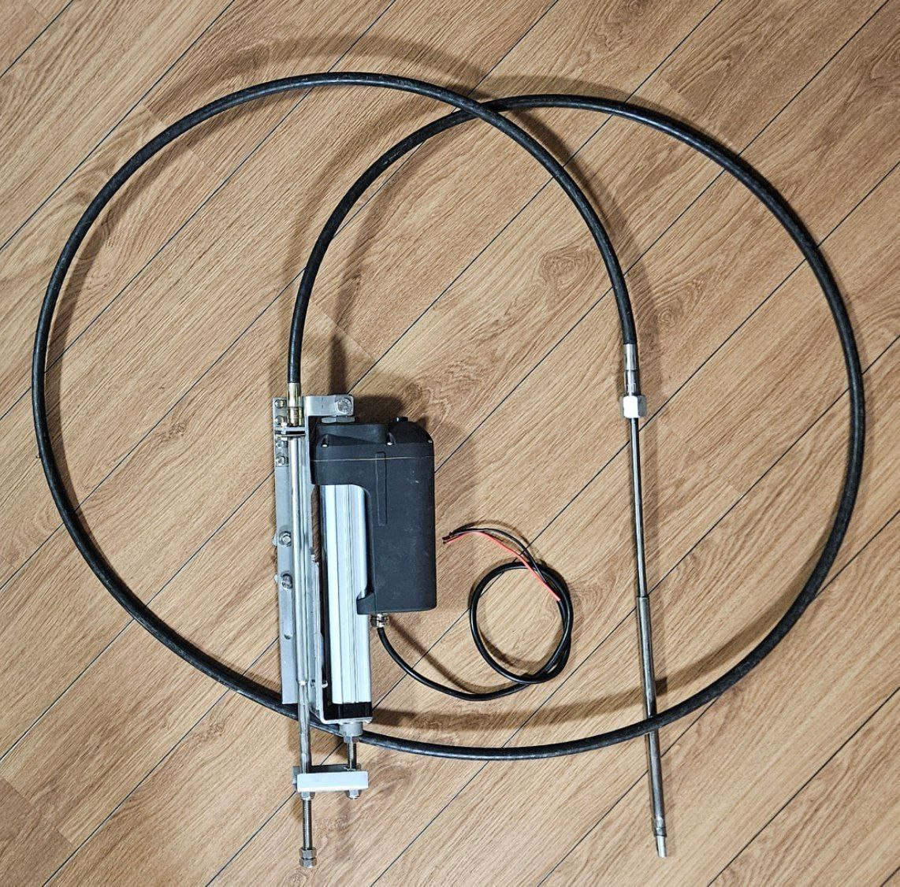
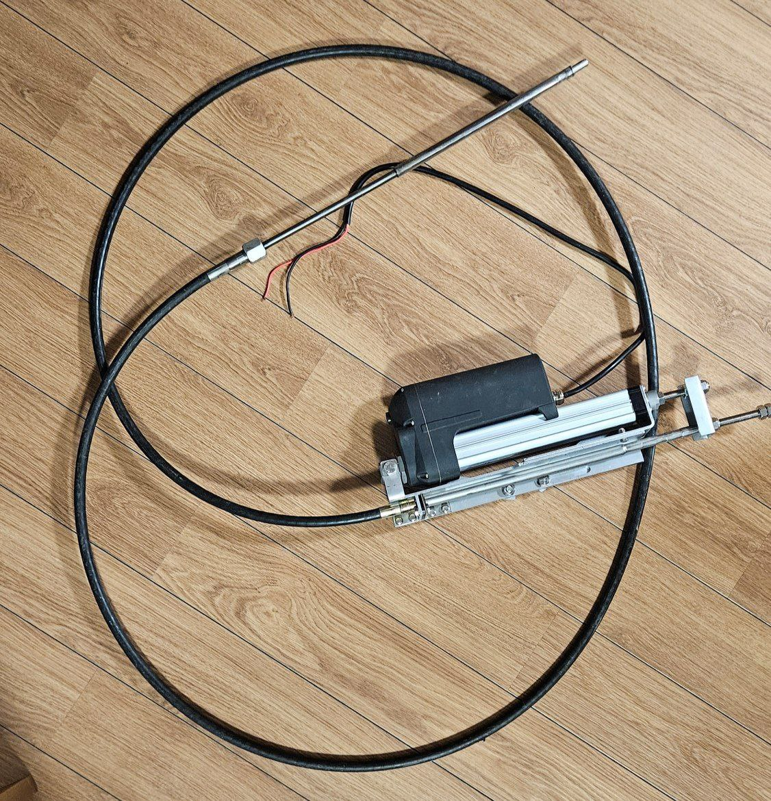

# Рулевой блок Motor Turn «MT425»

**Категория:** Управление моторами  
**Цена:** 286 000 ₽

Электронно-механический блок для дистанционного управления поворотом. Возможность подключения нескольких постов управления. Расположение постов на любом удалении от мотора.

## Галерея

## Подробное описание

Позволяет дистанционно управлять поворотом подвесного лодочного мотора мощностью до 115л.с. Возможно управление поворотно-откидной колонкой, пером руля. Включает в себя электроцилиндр, управляющий поворотом подвесного лодочного мотора через типовой рулевой трос M66.

Рабочее напряжение 12 В.

## Заказ и консультация

- [Написать в Telegram](https://t.me/+79276867402)  
- [Написать в WhatsApp](https://wa.me/+79276867402)  
- [Отправить email](mailto:1@vodoplav.ru)
