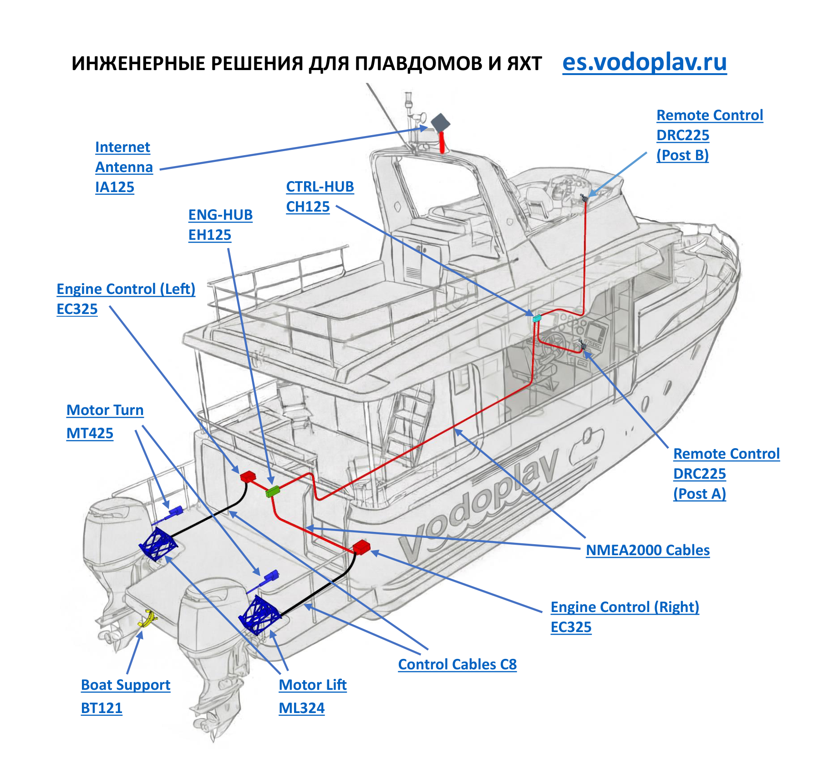

# Где что стоит на судне

Схема катамарана: наведите курсор на устройство и нажмите — откроется его страница.

<svg viewBox="0 0 595.3 567.0" preserveAspectRatio="none">
<a href="products/DRC225/"><rect class="hotspot" x="478.4" y="76.5" width="90.1" height="14.7" rx="3"><title>Remote Control — пост управления</title></rect></a>
<a href="products/DRC225/"><rect class="hotspot" x="478.4" y="91.2" width="85.1" height="14.7" rx="3"><title>Remote Control — пост управления</title></rect></a>
<a href="products/DRC225/"><rect class="hotspot" x="478.4" y="105.9" width="42.9" height="14.6" rx="3"><title>Remote Control — пост управления</title></rect></a>
<a href="products/EC325/"><rect class="hotspot" x="400.8" y="436.9" width="120.7" height="14.6" rx="3"><title>Engine Control — управление газом/реверсом</title></rect></a>
<a href="products/EC325/"><rect class="hotspot" x="400.8" y="451.5" width="34.8" height="14.6" rx="3"><title>Engine Control — управление газом/реверсом</title></rect></a>
<a href="products/DRC225/"><rect class="hotspot" x="490.6" y="324.5" width="90.1" height="14.6" rx="3"><title>Remote Control — пост управления</title></rect></a>
<a href="products/DRC225/"><rect class="hotspot" x="490.6" y="339.1" width="85.2" height="14.7" rx="3"><title>Remote Control — пост управления</title></rect></a>
<a href="products/DRC225/"><rect class="hotspot" x="490.6" y="353.8" width="43.4" height="14.6" rx="3"><title>Remote Control — пост управления</title></rect></a>
<a href="products/ML324/"><rect class="hotspot" x="201.8" y="493.8" width="63.5" height="16.9" rx="3"><title>Motor Lift — подъём мотора</title></rect></a>
<a href="products/ML324/"><rect class="hotspot" x="201.8" y="510.7" width="38.3" height="25.0" rx="3"><title>Motor Lift — подъём мотора</title></rect></a>
<a href="products/EC325/"><rect class="hotspot" x="39.1" y="204.0" width="113.5" height="14.7" rx="3"><title>Engine Control — управление газом/реверсом</title></rect></a>
<a href="products/EC325/"><rect class="hotspot" x="39.1" y="218.7" width="34.8" height="25.0" rx="3"><title>Engine Control — управление газом/реверсом</title></rect></a>
<a href="products/EH125/"><rect class="hotspot" x="135.6" y="149.6" width="61.5" height="14.7" rx="3"><title>ENG-HUB — коммутатор моторов</title></rect></a>
<a href="products/EH125/"><rect class="hotspot" x="135.6" y="164.3" width="36.2" height="14.7" rx="3"><title>ENG-HUB — коммутатор моторов</title></rect></a>
<a href="products/CH125/"><rect class="hotspot" x="207.1" y="128.9" width="61.7" height="14.6" rx="3"><title>CTRL-HUB — коммутатор постов</title></rect></a>
<a href="products/CH125/"><rect class="hotspot" x="207.1" y="143.5" width="36.7" height="14.6" rx="3"><title>CTRL-HUB — коммутатор постов</title></rect></a>
<a href="products/BT121/"><rect class="hotspot" x="57.0" y="493.8" width="72.9" height="16.9" rx="3"><title>Boat Support — упор для буксировки</title></rect></a>
<a href="products/BT121/"><rect class="hotspot" x="57.0" y="510.7" width="71.4" height="17.0" rx="3"><title>Boat Support — упор для буксировки</title></rect></a>
<a href="products/BT121/"><rect class="hotspot" x="57.0" y="527.7" width="38.3" height="25.0" rx="3"><title>Boat Support — упор для буксировки</title></rect></a>
<a href="products/MT425/"><rect class="hotspot" x="46.2" y="292.6" width="68.3" height="17.0" rx="3"><title>Motor Turn — поворот мотора</title></rect></a>
<a href="products/MT425/"><rect class="hotspot" x="46.2" y="309.6" width="39.2" height="24.9" rx="3"><title>Motor Turn — поворот мотора</title></rect></a>
<a href="products/IA125/"><rect class="hotspot" x="67.4" y="99.9" width="80.1" height="14.6" rx="3"><title>Internet Antenna — интернет-антенна</title></rect></a>
<a href="products/IA125/"><rect class="hotspot" x="67.4" y="114.5" width="80.1" height="14.6" rx="3"><title>Internet Antenna — интернет-антенна</title></rect></a>
<a href="products/IA125/"><rect class="hotspot" x="67.4" y="129.1" width="33.3" height="14.7" rx="3"><title>Internet Antenna — интернет-антенна</title></rect></a>
</svg>

